# DevApp / CN registry image release implementation plan

**Goal:** GitHub-hosted Runner builds once and pushes immutable ACR tags; either environment deploys an explicit tag, verifies, and automatically restores its previous images on failure.
**Architecture:** Reuse existing Dockerfiles/service map and the single-host image/schema verification engine. Add a registry producer, a fixed installed host entry, and one push/manual workflow. Keep existing deployment paths behind the inverse cutover flag until each host is prepared. No PR validation dependency. Deployment verification remains mandatory.
**User-approved scope:** This conversation's build → ACR → environment/tag → verify → rollback flow. DevApp and CN. PR checks may be skipped; this does not disable runtime checks.

## Tasks
- [x] Add failing regression cases for candidate startup failure, rollback failure, cancellation, registry tag/source mismatch, and missing host configuration.
- [x] Add opt-in automatic rollback and ACR provenance to `scripts/minimal-docker-release.py`; preserve existing archive callers and schema guard.
- [x] Add `scripts/registry-images.py` for five existing Dockerfiles, unique source/run/attempt tags and complete manifests.
- [x] Add fixed `scripts/deploy-registry-images.py` entry: trusted per-environment config, shared host lock, pulls before mutation, pinned config, persistent current image override, runtime/business checks.
- [x] Add build/deploy workflow for develop→DevApp and main-cn→CN, plus manual environment/tag selection. Hosted runners build; existing self-hosted runners consume.
- [x] Gate legacy automatic writers with the same cutover switch, document installation/config and perform focused tests and independent review.
- [x] Configure hosted-builder ACR access and install scoped fixed entries on both real hosts.
- [x] Verify fresh ECS pull credentials and actual full layer downloads on both hosts.
- [x] Inventory live/candidate schema bytes and read actual database migration history.
- [x] Resolve the initial rollout version boundary: user chose current-version runtime conversion, with database upgrade separate.
- [ ] Prepare DevApp application Compose baseline, fixed business probes, CN admission adapter and real host policies.
- [ ] Execute actual environment deployment, business verification and recovery acceptance before enabling automatic cutover.

```mermaid
flowchart LR
  A[Hosted build and ACR push] --> B[Both hosts download exact tag]
  B --> C[Schema and database inventory]
  C --> D[Initial version boundary]
  D --> E[Runtime preparation]
  E --> F[Deploy and business verification]
  F --> G[Rollback acceptance]
  G --> H[Enable automatic releases]
  classDef tested fill:#ddd0ff,stroke:#7950b3
  classDef blocked fill:#ffd6d6,stroke:#c92a2a
  classDef pending fill:#eee,stroke:#888
  class A,B,C tested
  class D tested
  classDef doing fill:#fff3bf,stroke:#f08c00
  class E doing
  class F,G,H pending
```

Actual initial candidate inventory: DevApp has seven pending database migrations,
CN sixteen. The candidate changes accounting column types; image recovery alone
cannot restore database semantics. The image-only schema guard remains enabled.
The user chose to build each existing environment's application version through
the hosted producer first and keep database upgrades separate. Added a build-only
exact source selector: control scripts remain at the workflow revision, while
Dockerfiles, application context, revision labels and tag identify the selected
source. Source overrides cannot deploy. The source selector and wrapper binding
have regression coverage; both current-version baseline builds now passed; real-host rollout remains pending.
See the dated evidence document for actual host observations.

## Constraints / rollout boundaries
- Do not alter database volumes, run migrations, or fabricate archive/approval evidence. Schema changes stop before activation.
- Existing DevApp uses systemd for API/Web: it needs a prepared full application Compose runtime before cutover; the dependency-only root compose is insufficient.
- Existing CN image namespace is reachable through a VPC address; hosted builders require a configured public registry endpoint and credentials. Do not invent them.
- Use existing environment locks and install a root-owned fixed deployment entry; never run checkout code through sudo.
- Production activation is not claimed without actual cloud and public business verification.

## Verification
Run stdlib Python regression suites, workflow structural checks, shell syntax checks, and report real cloud configuration limits. The checkout has no node_modules, so pnpm readiness/tick currently fail with `tsx: command not found`; per user direction broad pre-PR checks are deferred.

## Execution evidence and decisions
- Reused the existing checkout, fetched latest main, started `codex/unified-image-release` at `4e64506e3`; no new worktree.
- First regression run failed on the new rollback assertions; existing archive behavior remains opt-in unchanged. Subsequent 19-case engine suite passed before adding two further cancellation/digest cases.
- Producer 6/6 and host policy 5/5 passed. Python compilation, shell syntax and workflow YAML parsing passed.
- Independent review found and fixed recovery overlay/config-hash drift and stale automatic deployment ordering.
- Local real-Docker fixture correctly refused to claim Linux GitHub acceptance on macOS (`LINUX_GITHUB_ONLY`); actual Linux workflow dispatch remains required.
- GitHub ACR username saved from the user's console screenshot; user saved password directly. Public registry/namespace variables saved from screenshot and existing CN configuration. No secrets copied into repo.
- Public access initially disabled (user screenshot); user explicitly approved authenticated ACR access from all IPs. UI control can enumerate tabs but repeatedly times out on page/native interactions, so no browser-side cloud mutation was claimed.
- Implementation uses existing Dockerfile defaults resolved once to digest pins when optional base overrides are absent.
- Cutover stays disabled until host preparation and actual deployment/rollback evidence exist. DevApp currently lacks application Compose baseline; no systemd/data migration is performed implicitly.

- Final local engine regression: 21/21 passed (251s); registry 6/6 and policy 5/5 passed.
- Actual GitHub Linux Docker/Compose/HTTP integration succeeded: https://github.com/boardx/workspacex/actions/runs/40075718728 . Includes failed candidate → automatic rollback → subsequent successful release and owner-only cleanup.
- Official actionlint v1.7.12 checksum verified; new/modified build and integration workflows passed its checks. Corrected job-level `runner.temp` context after GitHub dispatch validation rejected it; no registry call occurred in that rejected dispatch.
- Independent final review: no remaining actionable findings; systemd recovery grace increased to360s.
- User enabled public ACR and removed whitelist per console semantics; public `/v2/` now responds401 with an auth challenge bound to the expected Shanghai instance. This is network reachability, not credential/push proof.

Capacity blocker resolved by user expansion: DevApp disk/root filesystem100G/~99G,44G available. Both current-version preloads passed; API/Agent inventories equal. Host preparation remains in progress: existing application verification credentials are not yet established, DevApp Compose conversion and CN admission policies remain pending. No service switch has run.

## Superseding CN-only rollout scope

The human now requests CN latest first and explicitly authorizes its database
upgrade after backup and recovery rehearsal. This supersedes the earlier
no-database-upgrade boundary for CN only; DevApp remains deferred. Issue5917
tracks frozen9eaedc66, build40097204900 and actual host preparation. Build/push
and CN exact-tag preload passed; no production migration or activation ran.
Fresh CN history confirms415 applied/16 pending. Existing wallet/transaction
tables are absent. Current backup/recovery inputs must be prepared rather than
reusing the historical255-row ba634319 rehearsal. Existing image-only schema guard
remains required; this candidate requires a separate admitted migration path.

## User-directed change: skip RDS restore rehearsal

The user asked whether the console snapshot restoration could directly rewind
current RDS and instructed that, if it could not, RDS restore-flow verification
should be skipped for now. The observed full-instance recovery page clones a new
RDS. Official PostgreSQL restoration documentation confirms full-instance recovery
to a new instance; database/table recovery to the original instance does not
overwrite existing data:
https://help.aliyun.com/zh/rds/apsaradb-rds-for-postgresql/restoration-2/

Accordingly, do not create or purchase a temporary RDS for this attempt and do not
continue the cloud restore rehearsal. No clone order was submitted by this agent.
The inspected draft was2c/4GB/100GB at1.17CNY/hour; this was a quote, not spend
authorization. Snapshot selector optionId3210944770 points to the21:48 backup.
The latest full snapshot remains available; actual recovery remains UNTESTED and
must not be recorded as passing. CN database upgrade authorization remains in
force, subject to migration compatibility checks and explicit recovery limitations.
Image rollback cannot be reported as SQL/data rollback. Required new-source host
configuration and a scoped migration deployment path remain unfinished.

## CN final result (supersedes earlier pending-state notes)

CN available2026-10-24T23:25:44+08:00 on frozen9eaedc66/build40097204900. Four immutable application images running/restart0; actual public authenticated Chromium and billing contracts passed. Complete431 migration checksums match. Schema and explicitly selected CN initialization were separate transactions; no cross-environment data copied. Encrypted current backup integrity passed, RDS restore user-waived/untested. A real failed activation automatically restored old images and passed public browser on forward schema; corrected activation-only retry succeeded without replaying database writers. Detailed evidence in `docs/evidence/registry-image-release/2026-10-24.md`; policy in `docs/operations/cn-schema-release-policy.md`. DevApp remains future work.

```mermaid
flowchart LR
  C1[CN 固定版本构建并上传 ACR] --> C2[当前数据库加密备份与结构升级]
  C2 --> C3[独立选择 CN 初始化]
  C3 --> C4[目标镜像激活与公网验收]
  C4 --> C5[失败自动回退实测与发布成功]
  C5 --> C6[发布记录与代码 PR]
  classDef todo fill:#e5e7eb,stroke:#6b7280,color:#111827
  classDef doing fill:#fde68a,stroke:#d97706,color:#111827
  classDef done fill:#bbf7d0,stroke:#16a34a,color:#111827
  classDef tested fill:#ddd6fe,stroke:#7c3aed,color:#111827
  classDef blocked fill:#fecaca,stroke:#dc2626,color:#111827
  class C1 tested
  class C2 tested
  class C3 tested
  class C4 tested
  class C5 tested
  class C6 doing
```

CN evidence above covers the five tested nodes. RDS restore is excluded by explicit user waiver. Original combined DevApp/CN diagram records the earlier scope; DevApp and future automatic schema admission remain pending.
