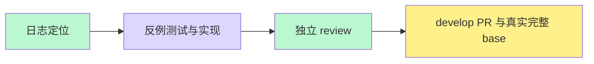

# 完整 base 的 API 并行执行（#5959）

40522651876 在 80 分钟超时前完成 371 个 API 文件、6795 项测试，无断言失败；非 API 阶段已消耗约 46 分钟。

保留本地完整 verify:ci-base；CI 单独执行非 API 图，同时复用 api-test-shards.json 的分片和实际发现覆盖证明。默认 API 分片成功后执行 exclusive。稳定 core 在去重前检查所有依赖，任何失败、取消、跳过或缺失均失败。API 日志、JSON 报告、SHA/run/attempt 身份与摘要进入最终证据，完整 manifest 只能在合并证据后生成。

验证：依赖失败闭合、缺片/空报告/身份和哈希错误、现有 workflow 契约、实际 Vitest 发现和 Turbo 测试图完整性。API job 均安装锁定 Python 与隔离 PostgreSQL，保持原有串行 worker 设置，不删测试、不延长原有预算。
