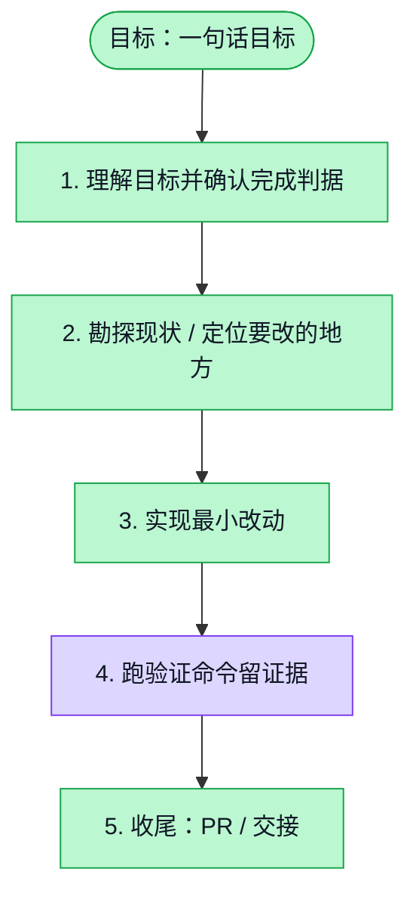

# 执行计划 — Sandbox 多用户容量控制（#5966）

> 规范：`.harness/instructions/execution-plan-visualization.md`。
> 改状态用 `node .harness/scripts/execution-plan.mjs set <本文件> <节点> <状态>`，
> 改完 `check` 一遍；不要手改 classDef 颜色。

## 我理解的目标
- **目标**：限制 sandbox 同时执行和排队数量，提供中文运行说明
- **完成判据**：sandbox test/typecheck；API 边界测试；部署生成器检查；容量 HTTP 行为验证
- **不做什么**：本轮不部署、不购买服务器、不实现跨机器路由或自动扩容
- **假设与待确认**：第一阶段服务内短队列；重启不恢复队列；用户明确无需网关

## 执行计划

图例：⬜ 灰=未开始 · 🟨 黄=已开始 · 🟩 绿=已完成 · 🟪 紫=已测试（有证据） · 🟥 红=被堵塞

## 进度日志（append-only，每次改颜色追加一行）
| 时间 | 节点 | 状态变化 | 依据（命令 / 证据 / 堵塞原因） |
|---|---|---|---|
| 2026-10-28 | G, S1 | todo → doing | 接到目标，开始理解 |

## Implementation plan

> **For agentic workers:** Use superpowers:executing-plans task by task.

**Architecture:** Add one reusable admission controller per sandbox service. Session commands and legacy scripts acquire capacity before probe/spawn; release only after process cleanup. Bind user quota at trusted API boundaries, retain Session authorization and execution deduplication. Waiting time consumes the existing deadline. No restart replay.

**Tech Stack:** TypeScript, existing Node HTTP and AbortController; generated sandbox contract; Vitest.

- [x] Add queue tests: concurrency, bounded FIFO eligible scheduling, per-owner quotas, timeout, cancellation, cleanup and metrics. Observe RED, implement minimal admission controller, observe GREEN.
- [x] Integrate Session execution and legacy /run; test real HTTP queue/overload/disconnect and child cancellation. Preserve cached results, token auth and cleanup.
- [x] Propagate trusted user ownership from native input visibility and legacy run/trial contexts; forward only hashed quota identity in private transport headers. Validate malformed identity; group missing identity conservatively.
- [x] Connect a stable optional capacity env_file to the canonical Compose generator and image template; keep defaults in contracts/runtime rather than duplicating numbers in deployment. Test actual generated environment.
- [x] Write Chinese operating guide and status/handoff. Run relevant full package suites, typechecks and boundary lint. Create PR, attach and follow CI; retain explicit unverified capacity/production boundaries.

**Ruling:** First stage uses a bounded in-memory execution queue instead of the earlier long-term PostgreSQL task queue. It protects both existing synchronous execution protocols without introducing task resumption/replay. Durable task admission and live frontend queue states are later work and must not be claimed delivered.

**Ruling:** Deployment uses a stable optional capacity env_file rather than extending the cloud provision schema. Runtime validates the file values; generated Compose and installer/US template parity is tested. This avoids copying capacity defaults into deployment config.

Delivery PR: https://github.com/boardx/workspacex/pull/5968 . Local verification and documentation/PR handoff are complete; CI is read live and followed by the author. Merge and production rollout remain outside this session.
