# Manual monthly pass implementation plan

> Execute inline with superpowers:executing-plans; final independent branch review.

Goal: CNY180 one-time calendar-month pass granting 20,000 expiring credit, with a concise, recoverable billing UI.
Architecture: preserve legacy recurring subscriptions and their callbacks; add separately persisted one-time orders and reuse the existing locked period grant/expiry ledger. Provider Checkout idempotency and server-side reconciliation prevent duplicate purchases and recover delayed callbacks.
Tech stack: TypeScript, NestJS, PostgreSQL, React, Stripe Checkout API.
Spec: ./2026-10-30-manual-monthly-pass-design.md (approved in conversation; #6038).

## Global constraints
- One calendar month, CNY 18,000 minor units, 20,000 credit, no automatic renewal.
- Preserve existing paid periods, CN historical test binding, permanent credit and audit history.
- No new worktree this session; reuse clean 23d9 checkout, baseline latest origin/develop after fetching main.
- No live financial mutation during implementation. Existing recurring subscriptions keep management access until separately verified migration.

## Review focus
Cross-tab double purchase; ambiguous provider timeout; signed but incorrect amount/environment/owner; delayed duplicate checkout callbacks; expiry/month-end and permanent balance preservation.

## Tasks
- [x] 1. Persist independent monthly orders and shared contract constants/view. Add PostgreSQL tests for concurrent reserve, grant deduplication, wrong amount/session/owner, calendar-month end and expiry. Run RED before implementation; reuse period normalization under wallet lock.
- [x] 2. Add bounded Stripe payment-mode Checkout adapter with stable order idempotency. Reserve an order before network calls; resume the same order across retries. Check exact amount, currency, product, client reference and live/test mode on authoritative retrieval. Reconcile reads and signed callbacks through one transactional grant path. Preserve legacy callbacks/Portal; replace new recurring purchases with POST one-time checkout.
- [x] 3. Replace verbose subscription view with a compact price/status/action. Keep previous good data during refresh; one transient message at a time. Resume pending checkout after reload, bounded polling plus focus refresh, abort on unmount and disable duplicate clicks. Retain compact legacy management only where needed. Simplify wallet and remove provider configuration card. Add UI regression tests.
- [x] 4. Run API/Web typechecks, relevant billing suites, real PostgreSQL tests and browser view/payment-state coverage; inspect desktop/mobile screenshots. Document exact validation and any external boundary.
- [ ] 5. Commit, push, create develop PR referencing #6038, get independent review and follow CI to green. No automatic production charges or cancellation of historical test bindings.

## Ledger
- init.sh quick baseline passed (2026-10-30).
- harness tick failed closed: COORD_GATEWAY_URL absent in reused checkout; no substitute clock/lease asserted. Direct human task tracked in #6038.

## Execution status

```mermaid
flowchart LR
  G([CNY180 manual monthly pass]) --> S1[Confirm rules] --> S2[Implement order and UI] --> S3[Verify finance and browser] --> S4[Review and CI]
  classDef todo fill:#e5e7eb,stroke:#6b7280,color:#111827
  classDef doing fill:#fde68a,stroke:#d97706,color:#111827
  classDef done fill:#bbf7d0,stroke:#16a34a,color:#111827
  classDef tested fill:#ddd6fe,stroke:#7c3aed,color:#111827
  classDef blocked fill:#fecaca,stroke:#dc2626,color:#111827
  class G doing
  class S1 done
  class S2 done
  class S3 tested
  %% evidence S3: 121 API/PG and78 UI passed; browser and signed callback/PG evidence in PR6039
  class S4 todo
```

- PostgreSQL/API billing regression: 119 passed; Web billing UI regression: 76 passed.
- Local browser payment-state/geometry test passed; discovery navigation rerun uses a browser-sized 15s assertion budget after a cold Next route exceeded 5s. No product navigation was changed.
- API lint and Web full lint passed. Live merchant settlement is not claimed by local provider fixtures.
- Independent review identified legacy/manual overlap and long browser timer re-arm defects. Added reproductions: both overlap cases fail against pre-fix code, pass after fixes. Second payments now require durable operator reconciliation; legacy management remains visible. A 31-day fake-clock UI test proves expiry refresh beyond the browser timer limit.
- Exact same signed event replay initially returned 500 through the legacy audit capability; regression now returns 200 twice with one financial grant, using the existing serialized audit-read pattern.
- Real Next → authenticated Billing HTTP → signed Stripe HTTP callback → PostgreSQL → browser monthly-pass acceptance passed, including exact replay. Controlled upstream fixture: no real merchant charge claimed.

- PR #6039 created against develop. Independent exact-SHA review ACCEPT on 65bcb96e92d909ca72e5ee2e6664fc209ce158a2; CI in progress. Final screenshot review removed one duplicate expiry paragraph from the wallet card; expiry and policy remain on the monthly card.
