# Queue-verified source / post-merge dedup implementation plan

Tracking #6057, parent #6052. User approved completion of stages2/3.

## Observed stage2 prerequisite
#6056 merged through the actual develop queue. Candidate and final source are both 30bac748397349ae308a81cc2297cad78f91f9da, base924ec90dd32732c577ebf3d4e508d8bbe68e2706, PR head4c3d7d2a392ead8fcfc11e712028760f15fe5ea7. Five required checks from merge_group runs41177404250/41177404307 succeeded before merge. GitHub records the human enqueuer as merged_by; actor name alone is not queue provenance. Raw API proof is retained in task outputs. Live GitHub rules/runs remain authority.

## Source contract
- Source policy explicitly selects merge_group for new sources; missing field retains historical push semantics. Unknown/null events fail closed.
- Distinguish pre-split historical push, stage1 split push and current queue evidence. Standalone installed helper policy is generated; no arbitrary caller-selected profile.
- Exact source SHA, workflow path/ID, queue branch, latest run/attempt, complete jobs and backend dynamic matrix/native obligations remain bound. No candidate/source alias or ancestry-only substitution.
- Historical CN release proof reconstructs candidate-required checks before merge and also validates current runtime evidence; source policy requires queue proof even when merged_by is a human. Existing human/push hashes remain unchanged.

## Execution
- [x] Prepare source-event profiles, standalone generation, CN source proof and negative tests.
- [x] Move source workflows to PR/queue; keep full acceptance on queue/manual.
- [x] Keep automatic compile as sole queue build; base-compile waits for its exact evidence, while manual acceptance builds normally.
- [x] Add queue-ready PR readiness (live protection only) and actual queue full acceptance aggregate; no skipped-as-pass.
- [ ] Add queue-ready to effective required checks without dropping current checks/review rules, after this source is reviewable and before its candidate is admitted.
- [ ] Pass PR and actual candidate checks; protected queue merge; record immutable source evidence.
- [ ] Verify develop push invokes image build/release only for this application lane; actual migration/config/health/business/recovery checks stay.

## Event map
PR: required source quality/tests plus scoped specialists; queue-ready checks live queue routing and explicitly does not claim E2E.
Queue: complete final-combination acceptance, actual queue-ready aggregate must pass before merge.
Develop push: image build/manifest, queue-source admission, fixed host activation and actual deployment acceptance. No duplicate source regression or duplicate automatic shared-image publisher.
Manual: full/base acceptance, independent heavy Board measurement and diagnostics remain explicit; these are not reported as unconditional coverage.

## Verification
CI policy tests and regression mutations; native candidate selftests; actual CN frozen CLI legacy/queue fixtures; spec coverage; source generation; all workflow needs; pre-push; PR and queue CI; independent exact-SHA review. No live payment, refund, production configuration or production deployment is requested by this cleanup.

```mermaid
flowchart LR
 A[Real stage2 queue proof] --> B[Source evidence and routing]
 B --> C[Tests and review]
 C --> D[Required queue-ready cutover]
 D --> E[Actual protected merge]
 E --> F[Post-merge release verification]
 classDef todo fill:#e5e7eb,stroke:#6b7280,color:#111827
 classDef doing fill:#fde68a,stroke:#d97706,color:#111827
 classDef done fill:#bbf7d0,stroke:#16a34a,color:#111827
 classDef tested fill:#ddd6fe,stroke:#7c3aed,color:#111827
 classDef blocked fill:#fecaca,stroke:#dc2626,color:#111827
 %% evidence A: /Users/shenyangjun/.codex/outputs/ci-workflow-cleanup/queue-6056-proof.json
 class A tested
 class B done
 class C doing
 class D todo
 class E todo
 class F todo
```

## Actual candidate failure investigation (2026-10-31)

Candidate0306d05a1e90bc950ebcb37bcbcf33f144071d01 failed the newly activated complete base gate: local-runtime env parity found `BILLING_DEPLOYMENT` missing from its existing billing isolation group. The existing scan reproduced red; classifying this selector with the other cloud-payment inputs passes parity and child-process isolation (8 tests).

Candidate2f337f6cd4d081dd731e54a7da7261890ea2ed99 also exposed an F190 browser race. Its retained Playwright trace shows an empty composer still in `running` during historical-run restoration; fill/click issued a real `queued-messages`201 rather than the direct AG-UI request asserted by the test. The context journey now uses the existing fail-closed idle observer before filling, retaining its direct-request, committed reply, F190/L2 payload and reload checks. Browser acceptance remains required; an ENOSPC local attempt is explicitly not passing evidence.

The cancelled/failed candidates are not release evidence. Fail-fast remains a separate tracked change (#6060/#6061); its owner will synchronize after this producer is actually merged. Existing protected checks remain in place.

Local repair verification: billing parity/child-env 8/8; empty-composer observer 4/4; real isolated PostgreSQL/API/Next/Chromium L2 and F190 journeys 2/2 (2.2 minutes execution, plus resource admission). The initial ENOSPC attempt was discarded, owned build caches cleaned, then the actual journeys rerun successfully. Owned test containers were released; no shared database was changed. New PR/queue checks are still mandatory.
