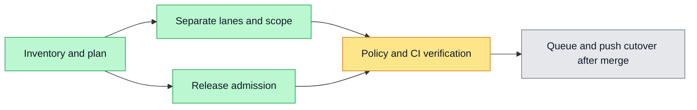

# CI lifecycle cleanup implementation plan

Goal: reduce irrelevant PR check creation and prevent release activation without exact-source verification, preserving existing required names and test coverage.
Architecture: automatic PR/merge-group verification and explicit manual acceptance have separate workflow entrypoints. Release builds may overlap tests; activation waits for the existing exact-source gate. Queue migration is staged: do not remove push validation or enable a rule whose workflow is not yet merged.
Spec: user-approved plan in this session, inventory at ~/.codex/outputs/ci-workflow-cleanup (snapshot, not authority).

## Tasks
- [x] Separate board manual-only jobs; retain their original commands/permissions and test the workflow routing.
- [x] Separate harness manual/full regression lanes from PR jobs without dropping develop-push integration evidence; explicit stable manual entrypoint.
- [x] Scope Skill imports by shared dependencies; preserve failure-default behavior and explicit manual run.
- [x] Add release admission to image deploy using the current exact-source integration helper; no production entrypoint rewrite.
- [ ] Verify all required checks on PR/merge_group, failure/missing/cancelled/retry behavior, YAML dependencies and branch routing.
- [ ] Open one PR for this coherent lifecycle cleanup, follow actual CI/review failures to green.
- [ ] After reviewed code is merged, activate merge queue only with complete required-check wiring; remove push source regression only in a subsequent verified cutover. Until then fallback remains intentionally active.

## Constraints
No deleted tests, fake approvals, production config changes, new scheduled automations, or arbitrary reuse across different source SHAs. Existing production approvals and same-image promotion remain. No additional worktree. Coordinator gateway unavailable; no claimed lease.

## Verification
Targeted harness policy tests (red then green), full harness test suite, YAML reference and dependency checks, init fast-path, PR CI. Independent whole-change review. Report staged queue/cutover state honestly.

