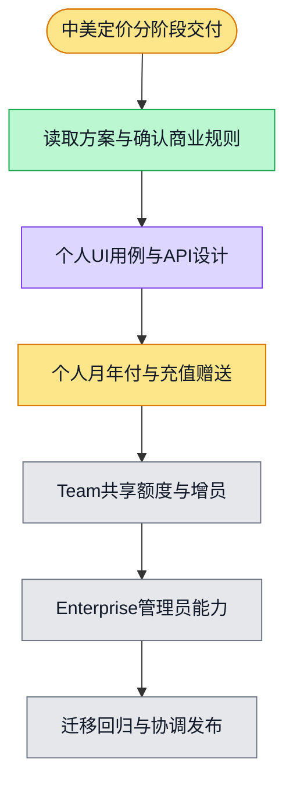

# 中美定价分阶段交付计划

> **For agentic workers:** Use superpowers:executing-plans 在当前会话逐项执行；本计划不授权并行子代理或生产操作。各阶段完成设计后再展开逐 feature 实施计划。

**Goal:** 按用户确认的中美定价交付个人、Team 与 Enterprise 支付和额度能力。

**Architecture:** 复用现有钱包、流水与支付回调，区分付款权益周期和月度额度周期。商业方案归属个人或付费组织，席位权益与实际成员数分离。

**Tech Stack:** TypeScript、Zod、NestJS、PostgreSQL、Next.js、Vitest、Playwright。

**Spec:** `docs/superpowers/specs/2026-11-01-cn-us-pricing-design.md` 为本计划需求输入；价格及业务裁决只引用该文，不另行复制。

## Global Constraints

- 微信月付与年付均一次性购买，过期手动续费；Stripe 自动续费。
- 年付按购买日锚点逐月发放额度，不提前发全年额度。
- Team 到期停止团队新 AI 请求；允许登录与查看资料；到期时已开始请求仍可完成。
- Enterprise 由平台管理员在 Team 列表手动升级。
- PR 仅目标 develop；共享 checkout 不切换分支；整个 session 只创建并复用一个隔离 worktree。

## Review Focus

- 月末与闰年：从原购买锚点计算所有月份，不能累计截断漂移。
- 年度购买和增员：付款成功不能提前释放未来月份额度。
- 并发和回放：新赠送、月度授予、增员及手动加额度必须各自幂等。
- 跨过期请求：已准入请求可结算，新请求不能凭余额绕过 Team 期限。
- 旧订阅清理：外部续扣、旧待支付订单和迟到 webhook 均须有明确结果。

## 1．设计与隔离

- [x] 读取图片、现有契约及发放逻辑，记录首轮证据边界。
- [x] 纳入用户七项裁决及三项补充回答，生成设计增量。
- [x] 协调共享 checkout，创建唯一隔离 worktree，基于最新 origin/develop；开发前 fetch main。
- [x] 在隔离 worktree 运行 `./init.sh`，失败先修基础；记录身份／tick 环境缺口。
- [x] 按单 feature issue／PR 录入本次用户交办原因，不借用旧 issue 宣称新价格已交付。
- [ ] 核对平台 Team 实际对应的数据实体、核心席位类型与新用户注册事务落点。
- [ ] 在 `phases/phase-21-billing-payment/design-deltas/` 准备本次增量材料；新增 UI 原型、用例、API 提案和覆盖矩阵，按仓库契约规则确定签核归属，不沿用旧 confirmed 状态冒充新签核。
- [ ] 在签核材料裁决增员首期额度折算及 Free 赠送到期策略。

## 2．个人支付与年付

涉及：`packages/contracts/src/billing-{credits,subscription}.ts`、`apps/api/src/application/billing/monthly-pass-service.ts`、`apps/api/src/infrastructure/billing/{stripe-monthly-pass-client,stripe-paid-credit-period,pg-credit-periods}.ts` 及支付目录迁移、`apps/web/components/billing/`。

- [ ] 先定义版本化目录与订单快照的失败测试，再实现中美金额／币种与新充值包；旧计费数据按用户最新裁决整体重置；旧事件被版本屏障隔离。
- [ ] 扩展微信一次性月／年购买及 Stripe 自动续费；验证付款归属、金额、币种及周期，不凭浏览器回跳发放。
- [ ] 以可控时钟的真实数据库测试覆盖十二个月、1 月 31 日、闰年、迟到发放和重复调度，再实现年度权益月度授予。
- [ ] 在新用户持久化创建路径增加一次性赠送；验证两个并发注册完成事件只产生一笔赠送，存量登录及切组织不赠送。
- [ ] 更新统一支付入口，浏览器覆盖 CN／US／DevApp 渠道、月年切换、余额百分比及历史金额。

## 3．Team 订阅与席位

涉及：现有 billing 契约／服务／仓库、`apps/api/src/infrastructure/billing/pg-credit-consumption.ts`、组织成员邀请／激活服务、`apps/web/components/billing/team-billing-overview.tsx`。

- [ ] 单独定义组织套餐与席位权益契约，测试基础席位与成员数无关后实现组织月度授予。
- [ ] 为增员报价、支付确认和席位生效建立一致版本及幂等测试，再实现补差价与共同到期；不得信任客户端计算金额。
- [ ] 测试并发增员、过期报价、重复回调和 Stripe 下一次续费席位数；校验两个组织不共享额度。
- [ ] 测试成员少于已购席位不降价、邀请／激活超额的约定结果，再接入席位约束。
- [ ] 测试有效期边界：过期新请求拒绝、资料可查、已准入请求可结算、充值及组织透支不能绕过期限。

## 4．Enterprise 平台管理

涉及：`packages/contracts/src/platform-organizations.ts`、平台组织 repository／controller、现有平台列表前端、billing 钱包授予能力。

- [ ] 定义平台管理员升级和加额度契约；先验证普通成员与组织 admin 均无平台操作权限。
- [ ] 实现 Enterprise 持久化标识及列表刷新；避免把组织内 team 误作付费组织。
- [ ] 实现手动加额度审计与幂等事务，测试重复提交、无效数量、错误组织和数据库回滚。
- [ ] 浏览器证明管理员升级／加额度后真实 API 与钱包流水一致。

## 5．迁移、回归及发布交接

- [ ] 编写旧计费数据重置 dry-run 与执行清单，先在测试环境覆盖外部取消失败、迟到事件及重复执行。
- [ ] 每 feature 的 verification 在实现前固定，证据可入库；通过 harness 门控及当前 PR head CI 后交付 develop。
- [ ] 回归现有 `pnpm --filter @repo/api test:billing-provider`、`pnpm --filter @repo/api test:credit-runtime`，以及受影响包 typecheck；新增年付／席位／管理功能须有独立测试，旧测试不能代替新验收。
- [ ] 数据库与浏览器测试走仓库标准隔离外壳，结束后释放本 session 资源。
- [ ] 提交新镜像、迁移步骤与环境配置需求给部署会话，协调窗口；本会话不接管服务器终端或现有发布流程。
- [ ] 同一 immutable 镜像在 CN／US 验证，保存迁移与浏览器证据；未执行清理或发布就明确保持未完成。

## 执行状态

灰=未开始，黄=进行中，绿=已完成，紫=有验证证据，红=阻塞。

未完成的设计、实现、测试与发布均保持未完成；本计划未修改任何 feature passing 状态或人工签核状态。

## UI 阶段证据（2026-11-01）

Issue #6086；原型 `/preview/pricing`；截图与人工确认清单见 `phases/phase-21-billing-payment/ui-preview/pricing-v1/README.md`。命令证据见 `phases/phase-21-billing-payment/design-deltas/pricing-v1/evidence/`。UI 已获用户确认；正式 API 设计在 issue #6088 展开，后端阶段未开始。

2026-11-01 最新用户裁决：旧订单、订阅、余额、流水全部为脏数据，重置后按新系统运行；不实现旧权益恢复。此裁决覆盖早先保留旧余额／流水的建议。
