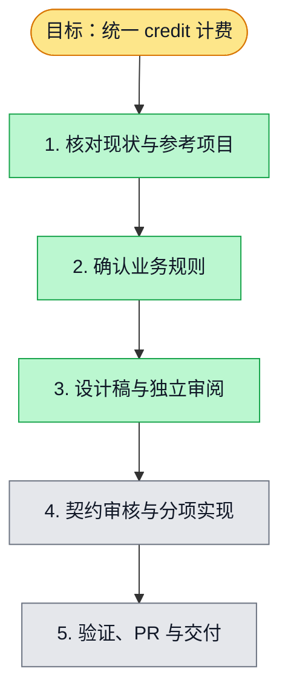

# 统一 credit 购买、订阅额度与企业透支设计

状态：需求与本设计均已由用户在会话确认；用户选择当前会话逐项实施，开发基线及首个合并目标为 develop。实现进行中，尚未迁移或发布。

## 目标与已确认规则

个人与原有国外订阅用户统一按模型实际消耗扣 credit，取消订阅无限使用的语义。复用已有支付渠道、钱包和用量收据。

| 场景 | 已确认行为 |
| --- | --- |
| 个人购买 | 支付确认后增加个人 credit；额外购买的额度长期保留 |
| 月订阅 | 每月发放 20,000 credit；未用完的当期额度到期清零 |
| 个人请求准入 | 请求开始时有效余额 >= 0 允许发起，< 0 拒绝；零余额允许发起 |
| 请求执行 | 已获准的请求允许完成，按实际用量扣费，余额可变负 |
| 企业 | 企业充值、企业付费；余额为负仍可发起请求 |
| token 计费 | 1 credit = 1,000 token，沿用逐物理请求向上取整至 0.01 credit |
| 查询 | 使用人和付款账户分别留存；个人查自身，管理员查组织与成员 |

仅实现上述业务范围，不调整充值价格、订阅价格或生产支付配置，不推测人民币与外币兑换率。

## 现状与方案选择

代码入口：`packages/contracts/src/billing-{credits,subscription,consumption}.ts`、`apps/api/src/infrastructure/billing/pg-credit-consumption.ts`、`pg-billing-stripe-webhook-store.ts`、`packages/contracts/src/ai-usage.ts`。

当前钱包支持两位小数和负余额；消费具备请求身份、用量收据及幂等结算。订阅只同步状态，尚无按周期发放；准入使用全局开关和最大用量预留，不符合本次“仅判断余额是否为负”的个人策略。现有用量查询已有组织与成员维度，但须关联实际 credit 结算。

参考 `/Users/shenyangjun/boardx/boardx-backend/src/credits/credits.service.ts` 的 token 换算、使用人归因和企业负余额；不照搬其个人/团队之间 fallback 扣款逻辑。

建议沿用单一钱包、增加订阅额度批次和分配明细。只维护一个总余额无法正确到期清除赠送部分；另建一套消费账本又会造成双重计费事实。新数据必须与现有消费流水在同一事务中写入。

## 额度与账本

以下为实现建议，随本设计审核，不是此前用户已单独确认的事项。

- 永久额度账户保留充值、历史余额及透支债务，可为负；订阅额度以周期批次记录授予量、剩余量、起止时间及付款凭证，剩余量不可为负。
- 有效余额 = 永久额度净额 + 所有未到期的订阅额度。读、准入、结算、充值共用同一计算与归一化逻辑，钱包总余额为事务内维护的投影，不能成为第二份规则。
- 扣费优先使用未到期订阅额度，剩余费用扣永久额度，允许后者为负。月度额度和后续充值都会提高净余额，不能绕过历史欠款判断。
- 例：订阅剩余 5、永久余额 2，请求花费 10，结果为订阅 0、永久 -3；再充值 2 后仍为 -1，个人仍不能发起新请求。
- 周期结束只冲销该批次剩余额度，不清除充值和欠款。到期流水不计入“模型消耗”。取消自动续费后，当期已付款额度保留到原到期时间。
- 余额读取或准入时必须先处理逻辑到期，后台任务只负责补写到期流水；不能因定时任务延迟而让过期额度继续使用。过期和新发放均有独立幂等键。
- 每次扣费保留一条消费事实，附额度来源分配；重放收据不能重复扣款。到期、授予、充值、消费分别可审计。

## 请求开始、并发与完成

- 请求开始在钱包锁内处理到期，读取有效余额并记录持久化准入。个人余额 < 0 返回 `credit_required`，企业跳过余额负数检查；身份权限、组织配额和账务故障仍按原规则处理。
- 不用“余额减最大预留”作为本次个人门槛，也不要求足够支付整次请求；全局开关不得绕过个人负余额禁发规则。
- 在余额尚未扣成负数前，多个请求可能均获准；它们全部可以完成。这是余额起始判定的自然结果，不额外施加单请求并发限制。
- 流式输出、实时语音同一已准入请求的后续增量不因余额变负而中止；每个计费片段须有唯一收据键，只结算新增量。新物理请求与真实重试需重新准入；相同请求 ID 的重放不重复执行或扣费。
- 同一物理请求按累计实际 token 计算目标扣费：`ceil(累计 token / 10)` 个百分之一 credit，片段仅扣目标总额与已扣总额之差；不逐片段独立取整。收据需注明累计快照或增量语义，统一归并后计算。重复片段不增加累计量，晚到旧累计快照不能使其回退，终态收据不能再重复扣费。
- 跨周期请求按实际结算时有效的额度扣费：先处理到期和已确认的新周期授予，再扣费；不重新启用旧额度。这一时间归属须在用量明细与测试中固定。
- 失败或取消但提供方已产生的真实用量仍计费；未知用量进入待核对，不能当作零用量。数据库失败不得静默免费或丢失结算。
- token 使用提供方的实际总量，不能重复计入已包含的 cache/reasoning 子项。仅返回时长的语音服务沿用显式原生单位费率，不伪造 token；本次不新增推测换算规则。

## 订阅发放与旧用户切换

- 使用支付提供方可验证的成功付款事实，按用户、订阅、有效月周期唯一授予 20,000；不是只收到 active 状态或浏览器支付回跳就发放。回调丢失可从付款事实对账补发。
- 月周期使用订阅账期锚点，持久化 UTC 起止时间；不按自然月一号发放。续费失败不发新周期，过期旧额度照常失效；迟到付款仅恢复其真实有效周期的权益，不能延长过期周期。
- 新账期发放和余额归一化在同一钱包事务中完成；重复回调、不同事件对应同一账单、乱序事件都不能多发或覆盖较新状态。
- 迁移前盘点真实现有 plan 和账期。建议已成功付款、仍在有效期的旧月订阅，在切换时为当期一次性补发完整 20,000，原账期结束时到期；不回溯赠送所有历史月份，也不补扣切换前无限使用的历史费用。
- 原有余额和历史充值全部保留；迁移须能重跑，补发与实时 webhook 共享周期幂等键。先完成旧订阅当期补发，再切换统一准入，避免用户被先阻断。
- 发现年付、试用、赠送或无法验证付款的旧套餐时，列出映射待确认，禁止把它们静默当月付发放。本次月付购买成功和续费成功路径须独立可交付；不在设计阶段猜测真实存量套餐。

## UI、查询与权限

- Billing 页面展示：有效总余额、永久额度/欠款、当期订阅剩余/20,000、到期时间、续费状态，以及个人负余额时的充值入口。订阅成功显示等待付款确认或已发放，不能只凭回跳加额度。
- 消费明细展示时间、使用人、付款账户、模型、实际 token、credit、请求标识、结算/待核对状态；充值、授予和到期分开显示。企业负余额提示待补缴，不阻止新请求。
- 个人查询包含本人发起的个人及组织用量，并明确付款方；个人钱包支出与本人使用量是两个不同统计口径。组织查询仅包含该组织付款的记录，管理员可按成员、时间、模型筛选。
- API 契约统一位于 `packages/contracts`：扩展钱包额度拆分和订阅周期发放状态；扩展用量 summary/calls 的已结算 credit、待核对数量和付款归属；新增个人自身用量读入口。逐请求汇总实际扣费，不按聚合 token 再取整。
- 普通用户只能查自己的用量，不能由参数冒充另一使用人；组织全量明细复用组织管理员鉴权。付款方只能由服务器的组织上下文与成员关系解析，不能跨钱包自动 fallback。

## 验收与交付拆分

1. 钱包额度批次、到期与充值：验证赠送优先扣、仅清零剩余赠送、欠款保留、跨周期和并发幂等。
2. 准入与统一消费：个人正/零余额通过，负余额零提供方 dispatch；企业负余额通过；在途请求完成、并发结算、流式增量与重放不重复扣。
3. 订阅和迁移：成功付款每周期恰好 20,000，重复/乱序/失败回调、补发重跑、旧用户切换及套餐映射边界。
4. 用户与组织查询和 UI：验证付款方与使用人分离、精确 credit 汇总、分页筛选、跨租户/跨用户拒绝访问，以及真实浏览器充值与订阅展示。

每项对应一个 issue/PR；实现前补齐契约束 UI、用例、API 及一致性审核，执行受影响包检查、数据库并发/恢复测试、支付回归与浏览器证据。本文不标 feature passing，也不代表已经实现。

独立规划审阅已完成：补充了流式片段按物理请求累计取整、只扣差额的口径；其余核心规则无新增规划阻塞。以上仅为设计审阅，尚无业务运行验证。

## 执行状态

