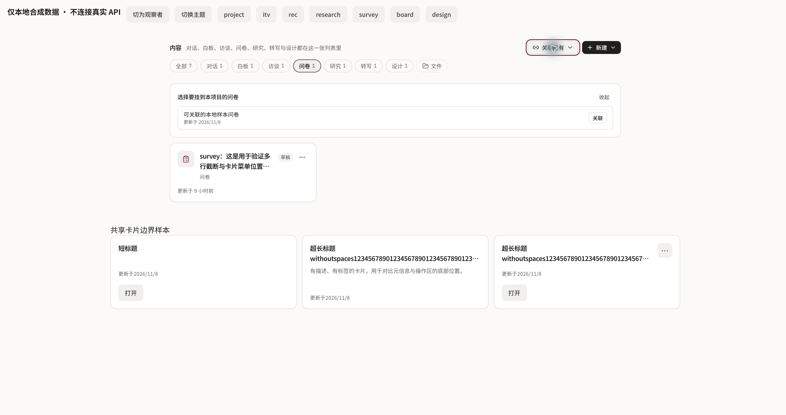
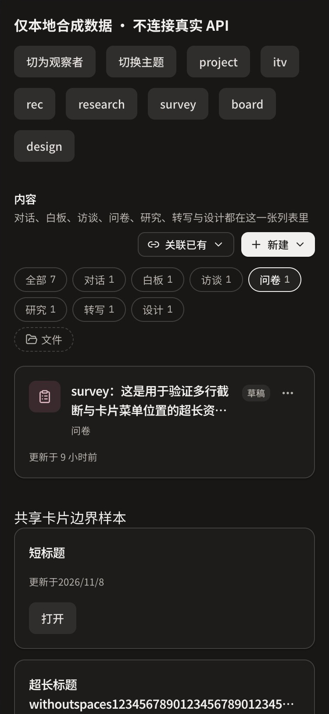
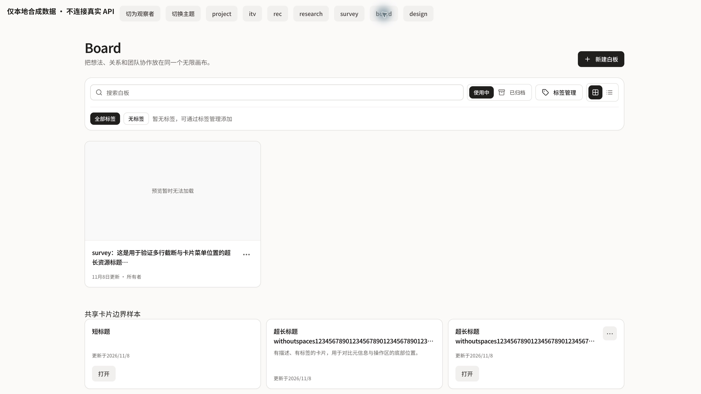

# Resource card and content toolbar alignment (#6442)

The project content view now uses one outer creation/association toolbar. Its seven type filters use the same full-width container, padding, comfortable card density, title wrapping, metadata placement, and responsive collection geometry. Standalone research tabs retain their toolbar. Creation and association remain scoped to the current type; the all view lists every supported type. Conversation sharing and resource unlink actions remain in their type views; this change does not add mutation menus to the all view.

`components/ui/resource-card.tsx` owns collection page/grid classes and the ResourceGrid component. Board, survey, interview, research, transcription, design, and project libraries reuse this geometry (one / two / three columns, 12px gaps). A chat conversation sidebar remains a sidebar. Card content and actions can change card height; no fixed height clips controls. Metadata follows the flexible content region, and linked, clickable and display cards share the same surface.

The first browser pass found a StrictMode regression in the new initial-association intent ref: effect replay closed the newly opened picker. The reset now only occurs for a changed type or revoked permission; the real entry is covered under React.StrictMode, and browser recheck passed picker open, close/type-switch, explicit reopen and permission downgrade. Earlier screenshots after-10/11 are not passing evidence.

Repeated empty-state create buttons and the research trailing create tile were removed; header creation, clear-filter recovery, permissions, management menus, and survey creation-mode selection remain. Survey report navigation is outside the resource grid. Publication data retains priority; missing publication plus an unknown/non-authoring status does not fabricate a draft badge.

## Verification

- `./init.sh`: quick baseline PASS.
- `pnpm harness readiness`: completed; user-directed consistency work recorded on issue #6442.
- `pnpm harness tick`: unavailable because COORD_GATEWAY_URL is not configured; no heartbeat is claimed.
- Before implementation: new seven-filter uniqueness/scoped-entry checks and whiteboard outer-entry behavior produced 8 FAIL, 21 PASS. An initial wrong test filter key was corrected before this counterexample was rerun.
- Project/resource regressions: 31 + 11 + 13 + 4 tests PASS across project-workbench-non-workshop, project-resource-section, resource-card and project-interview-status. Includes observer protection, seven scoped association menus, permission downgrade and closing/reopening association intents under StrictMode.
- Libraries: interview 28, transcription 34, research 33, survey 28, projects 17, whiteboard 26, design creation 6 tests PASS. The new research empty-state check initially expected a step callback, corrected to assert the existing link navigation; research suite rerun 33 PASS.
- Design workbench home subset: 52 PASS, 218 unrelated tests skipped using `-t 'PM 设计工作台首页'`; not a full design suite claim.
- `apps/web/scripts/lint-design.sh`: PASS across app/components/lib.
- ESLint: all changed source and test files PASS (`--max-warnings 0`); `git diff --check` PASS. `pnpm --filter web typecheck`: exit 0 after removing the temporary preview and its generated route type (`/tmp/content-card-typecheck-clean.log`). The previous temporary-preview-only undefined-array-index errors were not product errors and were not counted as PASS.

## Browser evidence boundary

The local temporary preview renders the actual ProjectContent and library components with synthetic HTTP boundary data. It blocks mutations and uses a complete synthetic session; the first attempt with an isolated token was correctly cleared by SessionProvider and was repaired only in the fixture. This is presentation/interaction evidence, not production API, persistence, model, ASR or deployment acceptance. Temporary route and generated types are removed before commit.

## Reviewable visual artifacts

[Browser verification matrix and failure ledger](browser-report.md) records PASS and NOT VERIFIED boundaries. [Screenshot manifest](screenshot-manifest.json) retains SHA256 identities and local paths for the raw captures, including failed attempts. Three product-only crops remove unrelated browser tabs/DevTools; no product pixels were retouched. The desktop Board image intentionally retains its unavailable thumbnail fixture; thumbnail rendering and Board no-match search are not accepted by this evidence.

The report covers all seven project filters at desktop, survey at 375px in light/dark themes, and an eight-item design list reaching its final row. It does not claim numeric DOM overflow measurement or every library in every viewport. The original production baseline report stays at `/tmp/ui-consistency-20261109/baseline-report.md`; the defect baseline is duplicate nested headings/actions and content-dependent inner widths. Production is not deployed.
