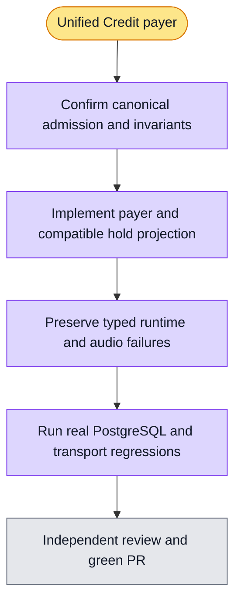

# Unified Credit payer — issue #6407

Enterprise member allowance is checked before each new physical request. If it cannot cover that request, personal Credit must cover the entire request. Non-enterprise organizations use personal Credit directly. Insufficient personal capacity refuses dispatch; it never grants unmetered execution. Existing requests keep their admitted payer, including receipts after membership, plan, or calendar changes.

Unknown-cost requests reserve the remaining personal spending capacity until an authoritative receipt releases it. This is a conservative capacity reservation, not measured usage or a debit. It can temporarily prevent another request using the same personal wallet across organizations. Unknown outcomes keep their reservation; elapsed time does not prove zero consumption.

The existing gross wallet hold must keep its meaning for old writers. Personal admission needs the unconsumed part of outstanding holds because partial receipts already reduce balance. The implementation uses an additive wallet projection maintained by database request changes; it does not transfer incurred team charges to personal Credit or rewrite historical consumption.

The runtime persists only allowlisted Credit codes, optional monthly-limit reason, and server-derived payer identity. SSE and polling expose the same projection after restart. Payer identity is checked against an auxiliary operation before constructing its recharge guidance. Provider text, arbitrary URLs, balances, prompts, and original exception messages cannot trigger recharge. Legacy class-only errors remain unclassified.

No production deployment, payment, allowance edit, or production migration is part of this change. Repository tests do not establish China production acceptance.

## Migration and maintenance boundary

`20261108120000_credit_remaining_holds.sql` takes wallet and request table locks with `NOWAIT` inside the normal atomic migration transaction. If activity conflicts, the transaction must roll back and the release must retry later; never kill sessions or remove the lock guard to force it through. The migration backfills only the new projection and installs an invoker trigger. It neither changes balances nor the existing gross hold. Old receipt writers continue to maintain the new projection through the trigger after the migration commits. Rolling back application code stops reading the new projection; leave the additive column and trigger in place.

Business admission and receipt paths acquire the organization financial lock and wallet row lock before request changes. Owner maintenance or repair SQL must also lock affected wallets in deterministic order before updating or deleting requests, then perform all related accounting changes in the same transaction. Runtime retains its existing lack of request DELETE permission. Arbitrary request-first SQL is not promised to be deadlock free: PostgreSQL may abort and roll back one transaction, which the operator must inspect and retry safely. Never replay a model call to repair accounting.

## Validation evidence

- Runtime regression: `pytest tests/test_self_hosted_runtime.py tests/test_standard_audio_tools.py`: 29 passed. Before implementation, typed polling failures were 3 failing cases and typed audio failures were 2 failing cases.
- API Credit runtime suite: 44 passed before adding two SSE refusal cases; the SSE-specific suite then passed 6 cases. Scope includes actual payer validation against the auxiliary operation and generic provider text remaining generic.
- Credit UI regressions: 26 passed, including scoped recharge, ownerless legacy account review, draft retention, and accounting-unavailable without a recharge action.
- API TypeScript check passed before payer integration; final integration checks remain pending.
- Candidate isolated PostgreSQL matrix: 11 passed before integration. This is not a substitute for existing billing regression or final CI.

## Final integration and review

Personal continuation checks spending capacity after the receipt commits, excluding the current request's own remaining hold from other holds. A confirmed personal-policy stop preserves reported counters; a receipt write failure, including a `null` rejection, remains unknown. Live organization writability and membership are checked before further use; revocation never prevents settling incurred charges. Concurrent revocation does not retroactively cancel an already dispatched response.

Independent coordinator security review binds `member-credit-quota.ts` to Git blob `28771013e1df7dd6af91ec004d26de99d98bb08f`. The financial drift snapshot is regenerated with the existing official tool after review. No new database privilege, definer function, or runtime request-delete permission is introduced.

Latest evidence:

- Integrated PostgreSQL and actual WebSocket run: 21 ordinary cases and 30 required serial cases passed, including next-session personal fallback after Enterprise quota exhaustion while the prior team charge stays fixed.
- Final payer/concurrency/live-authority matrix: 15 passed. Clean old-function organization counterexample incorrectly resolves continuation instead of rejecting. Initial parameterized fixture collision is documented separately and is not counted as a security counterexample.
- Continuation focused matrix: old function 2 failed, new function 2 passed through standard isolation. Unknown outcomes retain capacity; authoritative reconciliation releases it.
- Finalization counterexamples: 2 failed before the fix; final focused unit suite 7 passed, including `null` receipt rejection remaining unknown.
- Full billing discovery run earlier: 109 files, 820 passed / 36 failed / 3 skipped, plus a failed fixture setup. This is retained as a diagnostic run, not a passing claim. Rule-conflicting expectations were updated with explicit Enterprise or funded personal fixtures. Independent baseline historical replay and global catalog pollution repairs are tracked in PR #6413 and issue #6414.
- Normal mixed-version compatibility preserves old gross accounting and maintains the additive projection. Old admission code still follows its old product policy until all instances run the new code; the new strict admission guarantee applies to the updated entry point.

Independent review reopened transport/UI integration: the main public Chat run previously retained only the Credit error code. Persisted, requester-bound `creditFailure` must survive polling, restart, and public SSE; another viewer must not receive the requester's personal recharge action. Poll/SSE UI counterexamples initially failed 3 cases and now pass alongside existing notice regressions; backend persistence and public projection validation remain in progress. Accounting outages ignore stale recharge metadata, legacy ownerless failures never invent a payer, and monthly-limit stops never become a payment instruction.

The public-run review gap is now verified in the ordinary shared environment without test-only aliases: 6 PostgreSQL/real-HTTP projection cases plus 42 executor cases passed. Real `AgentRunController` and `PrincipalGuard` serve polling and SSE before and after app restart; requester guidance persists, authorized coworkers retain visibility without personal scope, anonymous reads return 401, and observer calls dispatch no model or executor. The actual Chat panel recovers the inline personal recharge entry from persisted messages after remount without resubmission. API runtime regression including legacy failure-call compatibility: 59 passed.

Admission now rejects a non-writable organization directly at the canonical entry. The migration schema-qualifies its locks and uses `SET LOCAL row_security=off` as a fail-closed visibility assertion, not a privilege bypass: an actual role without BYPASSRLS is rejected with 42501 instead of silently backfilling from tenant-filtered rows. The final 17-case admission matrix passed; incurred receipts still settle after disablement. The migration runner executes each file inside BEGIN/COMMIT with rollback on failure; production role readiness remains a release check, not a claim made by these tests.

Final auxiliary compatibility check no longer reconstructs a payer from the current plan when a legacy private error lacks wallet identity. Only an explicitly bound payer, or the stable organization monthly-limit reason, can produce scoped guidance; otherwise accounting identity is unconfirmed and no recharge instruction is produced. The added counterexample failed before the fix; final runtime suite 60 passed and real auxiliary PostgreSQL suite 5 passed. Final API and web TypeScript checks exited 0.

PR #6415 review found an additional native-tool retry gap: the audio callback's typed Credit refusal could be retried by the actual `ToolRetryMiddleware` and converted to a recoverable ToolMessage. Four real native-graph sync/async × stable-code cases failed against the previous implementation. The retry predicate now rejects `CreditRuntimeUsageError` separately from recoverable tool-outcome classes, so the same exception reaches durable failure projection without replay or model continuation. Real audio HTTP callback tests cover both typed codes and an unclassified unknown-outcome control, each with exactly one callback. Native graph/retry, audio, persisted runtime, and model Credit regression: 62 passed. This is a local regression result; the updated PR head requires its own CI.
