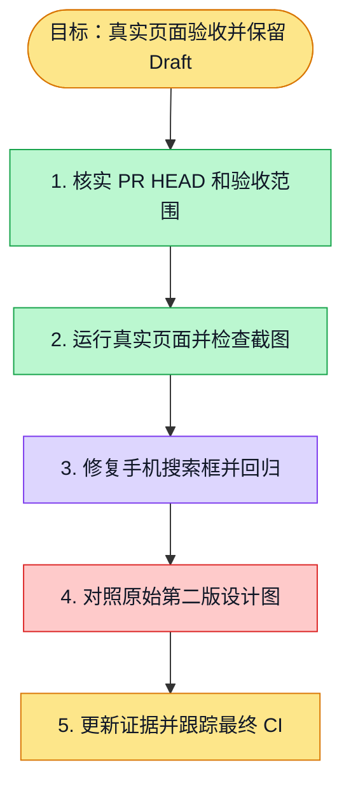

# 执行计划 — 数字人目录第二版视觉验收

> 规范：`.harness/instructions/execution-plan-visualization.md`。
> 改状态用 `node .harness/scripts/execution-plan.mjs set <本文件> <节点> <状态>`，
> 改完 `check` 一遍；不要手改 classDef 颜色。

## 我理解的目标
- **目标**：对第二版角色卡片目录完成真实浏览器视觉和交互验收。
- **完成判据**：三档截图、原图对照、真实启用刷新和草稿预填、目录回归与最终 HEAD CI。
- **不做什么**：不新增权限，不修改生产，不部署、不合并，保持 Draft。
- **假设与待确认**：原始第二版图片缺失，已请求用户提供；文字规格来自 #5704。

## 执行计划

图例：⬜ 灰=未开始 · 🟨 黄=已开始 · 🟩 绿=已完成 · 🟪 紫=已测试（有证据） · 🟥 红=被堵塞

## 进度日志（append-only，每次改颜色追加一行）
| 时间 | 节点 | 状态变化 | 依据（命令 / 证据 / 堵塞原因） |
|---|---|---|---|
| 2026-10-15 | G, S1 | todo → doing | 接到目标，开始理解 |
