# Administration member quotas localization — #6212

The real `/admin/members` three-tab flow now localizes member quotas, the policy boundary/live limit-rule controls, and usage summary/ledger across Chinese and English. Drafts, selection, raw authored names/emails/IDs/braces, canonical request values, authorization, currency/precision/calculations and private-layer visibility remain intact. Stored feedback/errors translate on render; locale changes preserve request and timer behavior.

Actual accepted prerequisites are integrated normally: profile/home6203, research/interview6205, numeric409 guidance6219/ec, workflow-grants6211/4119, and shared403 maintenance6223/b0. Current measured application/test source is `9194ab5de3754e79d03c640928b835efbeaa02e6`; evidence-only runtime freeze `7463e7a0b0d5822b4f7e318505c399f80bb5f33d` is byte-equivalent outside evidence. Protected tree, exact browser statement/import union and additive registry proofs are in accepted-api/, accepted-workflow/ and final-merge/. The workflow integration has an independent bounded CLEAN report; prior whole-source/task/grammar reviews are retained beside this file. Static nonliteral-expression preservation is not mislabeled as cross-revision runtime-value equality.

Fresh merged-source gates all exit0: Webtype52.746s;88/88 tests across10files18.773s; scopedESLint2.362s; init11.217s; test-ID4.167s; canonical exact-one-test isolated listing4.399s. The list scope haszero containers/volumes/all11listeners. API/packages/listed root typed inputs are byte-identical to4639, whose APItype0/43.639s is reused for that same source; normal publication hooks still verify the current graph. Unchanged full-spec/wiring registrations keep their earlier receipts; current one-case discovery and test-ID checks are fresh. See final-merge/ for each actual receipt and reuse boundary.

The third real Chromium→API→PostgreSQL journey actually passes1/1 in18.175s (runner688.695s), retry0/skipped0/flaky0, producing the original17screenshots. Root individually inspected every image, then copied only those exact safe PNG bytes and curated result/cleanup/hash/QA receipts into browser-third/. Real budget/quota/rule writes, server readback/reload, valid-member403/no-mutation, real usage receipts and locale continuity are asserted by the journey. Component regressions additionally pin deferred replies, caller errors, snapshot/cursor and numerical-format behavior; they are not represented as real network-outage or multi-page browser evidence.

All prior observed copy findings are addressed: both valid-member error cards show permission guidance; Rules:1, Calls with unreported usage:1 and Records on this page:1 replace singular grammar errors; the English quota guidance has its sentence gap. Mobile budget/quota/rule dialogs retain raw decimal drafts and full Close/Cancel/Save reachability. The rejected500001 draft and server-projected500000 guidance remain visible; unallocated487500 is the separate replacement-budget caption, not a changed calculation. Detailed per-frame observations and hashes are in browser-third/screenshots.json and qa.md.

Presentation/coverage limits stay explicit. The upper degradation prototype retains its no-live-backend warning; the separately titled live rule section is backed by actualCRUD, not proof of degradation/model execution. Wide ledger columns use their existing contained horizontal scroller; lower sections and all columns are not simultaneously visible in900px frames. The existing shared transient toast overlaps the mobile bottom navigation in one frame. No new actionable P1/P2 was observed in this localized scope. Historical seeded receipts are read through real APIs/PG; they do not prove external provider quality, charging/settlement, or complete personal B9 billing coverage.

Failure history is preserved rather than relabeled: the first actual browser exposed missing409 numeric guidance; its five planned images plus a failure image were not17-image acceptance. The second actual case passed but17-image QA retained403/grammar findings. Independent API/shared403 prerequisites and the minimal three-literal wave were accepted/checked before this single original17-image rerun. Earlier failed/discovery evidence remains source-bound in its own directories.

Raw browser logs, nativeJSON and traces are private; new native artifacts were written directly into the ignored private directory. An unsafe unpublished6ae commit remains only under its private retention ref and is not an ancestor of this branch. Accepted6219 legitimately contributes three benign metadata blobs; six other original non-PNG blobs (two benign metadata and four raw artifacts) remain absent in the documented known-nine guard. This is not a claim that all nine are absent or that the complete repository history is credential-free. Earlier formal safety-review boundaries and current limited guard are preserved; final tracked head-only credential scan is still a publication gate.

Local behavior and17-image QA are complete at the measured source. The bounded final integration/evidence review of44d43c411 is CLEAN with no actionable P1/P2; its report is included. Canonical tracked scan, normal push hooks, automatic independent PR and source/candidate CI/actual develop delivery remain required. Main owns the merge queue. No manual passing state, completeB8/B4/B9 claim or production deployment is made here.

```mermaid
flowchart LR
 A[Implementation and semantic RED]:::tested --> B[Actual prerequisites and merge checks]:::tested --> C[Real API browser and17image QA]:::tested --> D[Bounded final review]:::done --> E[Normal hooks and independent PR]:::todo --> F[Green CI and develop delivery]:::todo
 classDef todo fill:#e5e7eb,stroke:#6b7280,color:#111827
 classDef doing fill:#fde68a,stroke:#d97706,color:#111827
 classDef done fill:#bbf7d0,stroke:#16a34a,color:#111827
 classDef done fill:#bbf7d0,stroke:#16a34a,color:#111827
 classDef tested fill:#ddd6fe,stroke:#7c3aed,color:#111827
```

## Accepted recording sync after PR creation

PR #6227 first observed a real conflict after develop advanced through #6220. Normal merge `ce8e561d461cf29d467e8cbc1c1a8e1177b6e559` preserves both locale registries and every protected path. Bounded independent review is CLEAN; each catalog has3,331 unique keys, exact parent union and unchanged retained expressions. Fresh impacted resources/count13/13, registrylint andinit pass. Quota source/test/E2E/config retain measured bytes; original browser/88-case results keep their original source attribution. See `accepted-recording/` for proof, review and curated gates. Normal update hooks and remote delivery remain separate required gates.

## First CI failure repaired in tests

Publishedc6a verify-affected exposed a legacy quota-live403 assertion still expecting relogin. Actual local original8 RED is1FAIL7PASS; test-only sourceb776 corrects403 and adds401 control, with other production/E2E/config bytes unchanged. Expanded bounded97/97 plus scopedlint pass, independent incrementreview CLEAN. See `ci-fix/` for exact source/run/receipts and the corrected adjacency-selection gap. RemoteCI and actual merge remain required; no browser rerun or new full-project completion is claimed.

## Second CI failure: reduced debt baseline

The next0638 controlplane run found six reduced raw-error counts whose LEGACY records had not yet been tightened. Source44f41de5 only lowers those six counts and adds two isolated real-scanner negative cases, preserving original two tests and all product/API/E2E/config bytes. Original scannerRED0.394s→GREEN0.426s;4/4 selftestsGREEN5.357s; boundedreviewCLEAN. See `ratchet-fix/`. The scanner is unchanged except numeric reductions, remaining debt is explicit, and new remoteCI/actual delivery still required.
