# Complete administration quota page — implementation plan #6212

Spec: [design.md](design.md). Root owns semantic tests, static/runtime verification, browser artifacts, resource handoffs, Git and GitHub. Product tasks execute sequentially with fresh bounded implementers and independent task reviews; no simultaneous implementers. Whole-branch most-capable review at the end.

## Global Constraints
Preserve all binding invariants in design.md: canonical data/IDs/enums/permissions/requests/math/nulls, numeric parsing/truncation, BigInt money/currency/region, fixed date-query timezone/buckets/cursors/asOf, org-keyed identity reset and lifecycle guards. Locale is rendering only. Pure typed resources, Chinese defaults, safe semantic feedback, raw authored data and CSV formats. No backend/contracts/pricing/CI changes. No tests/type/lint/build/PG/browser/Git actions by workers; root serializes heavy windows. Workers are not alone, must not revert others, and must not spawn subagents.

## Task 1: Shared admin chrome, quotas, invitations and administrator boundaries
Own `components/admin/{members-screen,member-quota-tab,member-invites-panel,admin-boundary-live,admin-header,view-mode-toggle,no-backend-notice}.tsx`; new pure namespaces `lib/i18n/namespaces/{admin-common,admin-member-quotas}.ts`; optional display/error helper `lib/admin-member-copy.ts`; namespace registration only in messages/en.ts+zh-CN.ts. Existing panel.tsx already translates its actual generic controls: inspect and reuse; do not modify it without a demonstrated requirement. In org-admin/org-admin-screen.tsx export the existing inviteStatusLabel and add own-property fallback if needed; independent Task1 review additionally authorizes only the existing describeInviteFailure unknown-error fallback to reuse safe canonical failure handling (known invite mappings and all form logic unchanged); reuse InviteMemberForm.onNotice and its semantic function, keep string callbacks backward-compatible and all invitation logic untouched.

Translate entire shell props/preview copy, card/list toggle, header organization/platform/quota states, quota cards/inputs/actions/progress/validation/errors/toasts, invite summary/status/resend/create modal/one-time-link context and personal-layer boundary/access log copy. Keep names/emails/IDs/objectRefs/readAt raw. Reuse role.* dictionary and current invite key map. Preserve null/0, Math.trunc and existing thresholds. Render errors/toasts from semantic/raw state so existing feedback retranslate without requests. Use callbacks carefully for function-valued feedback (`setState(() => fn)` or wrapper).

Root new test file(s) will define exact English labels and state behavior; do not edit tests to fit code. Preserve legacy Chinese behavior and all permission/lifecycle guards. Full self-review report `.superpowers/sdd/admin-member-quotas-6212/task-1-report.md`; no tests run by worker.

## Task 2: Live limit rules and truthfully labeled degradation prototypes
Own `components/admin/{limit-policy-tab,limit-rules-live}.tsx`, used display metadata only in `lib/mock/admin-limits.ts`, pure namespace `admin-limit-policy.ts`, namespace registrations and optional display helper. Preserve all scope/window/action values, rule IDs/ref strings, request payloads/create/update/delete flow, caps/ratio logic and degrade-target requirement. Render all cards/list/detail/create/update/delete/validation/errors/notices in both languages, retaining drafts/view/scope/action on locale changes. Translate prototype labels/explanations/toasts and task-grading system copy, keep numeric/sample authored data/model names and no-backend disclosure; do not turn local toggles into requests. Default Chinese mock metadata references pure canonical resources, no duplicate literal authority. Root tests and task review before next task.

## Task 3: Usage windows and reused AI overview/ledger/format presentation
Own `components/admin/{usage-monitor-tab,ai-usage-panel,ai-usage-overview,ai-usage-ledger}.tsx`, `ai-usage-format.ts`, presentation-only optional locale in `lib/ai-usage-chart.ts` if required, pure namespace `ai-usage.ts` and registrations. Preserve query/selection/date preset/custom-date/cursor/asOf/grain/metric/model/member/project keys and lifecycle guards; do not add locale to keys/effects. Reuse memberLabel optional locale. Translate all labels/tooltips/aria/filter/date/error/loading/empty/native-measurement/credit/cost/source breakdown/paging/detail UI. Helpers keep default Chinese signatures and exact BigInt/currency precision, null/0/unreported/native distinctions. Keep canonical day/dateQuery/timezone and aggregation untouched, separate currencies unchanged. No file export/data format rewrite. Root semantic/format RED and regressions before implementation; report and task review. Task3 independent review additionally permits a minimal bilingual copy correction: failed calls may include reported token usage, matching canonical aggregation; no usage/math/pricing change.

## Final acceptance
Root consolidates tests/type/lint/static gates, freezes source and runs fresh authenticated real browser/API with desktop/mobile screenshots, meaningful counterexamples and cleanup. Correct actual usability defects within owned surfaces without force-clicking or changing timeouts. Final whole-branch review and bounded fix/scoped review, normal push, automatically create explicit stacked PR with Closes #6212. Parent integration and CI/merge stay main-owned; no passing/merge claims before real evidence.

```mermaid
flowchart LR
 A[Task1 semantic tests and scope]:::tested --> B[Chrome quota invite boundary]:::tested --> C[Live rules and prototypes]:::tested --> D[Usage and precision-preserving presentation]:::tested --> E[Real API browser and review]:::doing --> F[PR and develop integration]:::todo
 classDef todo fill:#e5e7eb,stroke:#6b7280,color:#111827
 classDef doing fill:#fde68a,stroke:#d97706,color:#111827
 classDef done fill:#bbf7d0,stroke:#16a34a,color:#111827
 classDef tested fill:#ddd6fe,stroke:#7c3aed,color:#111827
 classDef blocked fill:#fecaca,stroke:#dc2626,color:#111827
```

