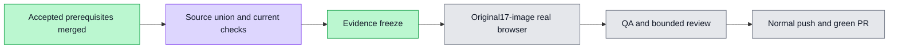

# Accepted403 integration and current quota gates

PR6223 actually merged at2026-11-04T07:33:19Z as `b0f94fea1cf16ceacfdc28054bb25ac612f599c2`; current GitHub mergedAt/mergeCommit/head were independently read. Normal merge source `9194ab5de3754e79d03c640928b835efbeaa02e6` combines that accepted commit with worker `56efe8dc915e366b06592506ef2ab69abee91e37`, which already contains accepted workflow4119, the three English count corrections and original-case permission/noexpired assertions.

Protected mode/type/object identity holds for23,459 common,165 worker-only and11 accepted-only entries withzero mismatches. Only the two dictionary registries overlap; relative to worker each gains the one approved common.http.forbidden line and nothing is deleted/edited. Relative to accepted each gains the eight existing quota namespace import/spread lines only. Eight E2E cases/ten exact statements, both relative orders and named imports are retained. The earlier four-overlap workflow integration has its independent CLEAN report in accepted-workflow/.

Current source checks all actually exit0:
- Web typecheck52.746s.
- Focused88/88 across10files18.773s, including quota/policy/usage/format, count copy, sharedHTTP fallback, existing artifact/design/home caller/resource/research regressions.
- Scopednine-file ESLint2.362s; infrastructure-free init11.217s; test-ID gate4.167s.
- Canonical isolated listing exactly1test/1file4.399s. Scope wsx-2eae5eb9e1d0fc511ef7 haszero containers,volumes and listeners on all eleven allocated ports after actual process exit; resource window released immediately.

API source, packages and the listed root typed-dependency inputs are byte-identical to already-validated4639; its APItype0/43.639s evidence is reused for the same source instead of an independent repeat. Normal push hooks will still verify the current graph. Playwright/CI registration and wiring scripts remain byte-identical to4639; prior full-spec/wiring receipts remain bound there. The current exact isolated listing and test-ID checks above are fresh, not a claim that every previous gate was rerun.

These checks establish current merged-source readiness for the one original17-image browser rerun. They are not a new browser pass, visual acceptance, source/candidate CI success or quota PR delivery. An evidence-only freeze must retain application/test bytes identical to9194 and a clean worktree before that run. The new403 assertions remain runtime-pending until that browser completes. Native browser logs,JSON reports and traces will be private; only individually inspected safe images and curated receipts may be committed.

