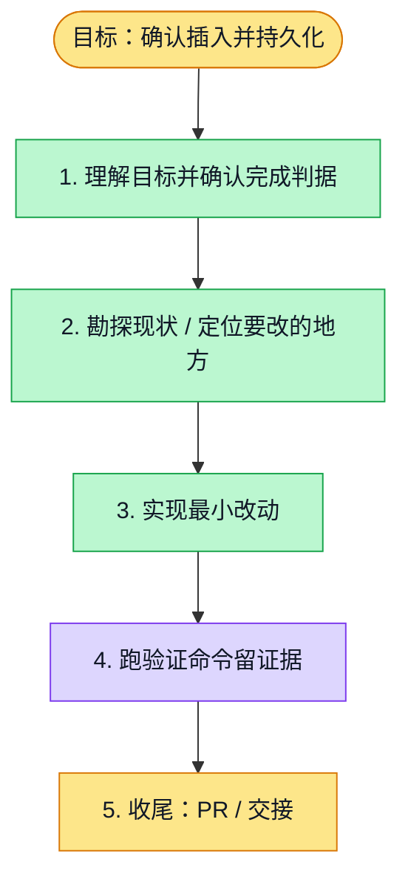

# 执行计划 — 聊天画布选择 Board 与位置预览

> 规范：`.harness/instructions/execution-plan-visualization.md`。
> 改状态用 `node .harness/scripts/execution-plan.mjs set <本文件> <节点> <状态>`，
> 改完 `check` 一遍；不要手改 classDef 颜色。

## 我理解的目标
- **目标**：将聊天生成的图表/模板插入所选项目或组织 Board，预览位置并确认持久化。
- **完成判据**：相关 UI/API/core 测试、全栈浏览器取消/拖动/确认/打开/刷新、typecheck/lint 与 PR 检查通过。
- **不做什么**：不改 Board 权限模型，不写 Fabric JSON，不做生产发布。
- **假设与待确认**：组织场景复用现有组织 Board 库；项目场景仅列已关联 Board。

## 执行计划

图例：⬜ 灰=未开始 · 🟨 黄=已开始 · 🟩 绿=已完成 · 🟪 紫=已测试（有证据） · 🟥 红=被堵塞

## 进度日志（append-only，每次改颜色追加一行）
| 时间 | 节点 | 状态变化 | 依据（命令 / 证据 / 堵塞原因） |
|---|---|---|---|
| 2026-11-09 | G, S1 | todo → doing | 接到目标，开始理解 |
