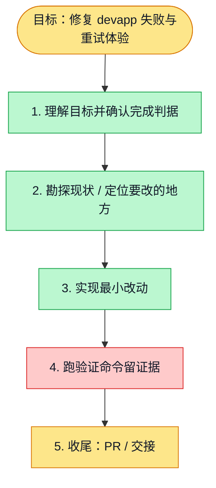

# 执行计划 — devapp 模型准入与失败恢复 #6241

> 规范：`.harness/instructions/execution-plan-visualization.md`。
> 改状态用 `node .harness/scripts/execution-plan.mjs set <本文件> <节点> <状态>`，
> 改完 `check` 一遍；不要手改 classDef 颜色。

## 我理解的目标
- **目标**：修复合法长上下文准入失败，改善重试体验，交付验证和合并提示
- **完成判据**：API HTTP 边界测试、前端恢复测试、类型检查/lint、浏览器验证及 PR 绿灯
- **不做什么**：仅准入解析器和既有失败恢复交互，不改变鉴权和计费决策
- **假设与待确认**：完整本地 E2E 依赖 Docker；线上生效需合并后手动发布

## 执行计划

图例：⬜ 灰=未开始 · 🟨 黄=已开始 · 🟩 绿=已完成 · 🟪 紫=已测试（有证据） · 🟥 红=被堵塞

## 进度日志（append-only，每次改颜色追加一行）
| 时间 | 节点 | 状态变化 | 依据（命令 / 证据 / 堵塞原因） |
|---|---|---|---|
| 2026-11-05 | G, S1 | todo → doing | 接到目标，开始理解 |
