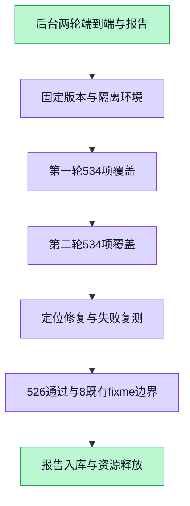

# WorkspaceX 后台两轮端到端测试报告

**最终：534 条计划项已完成覆盖；526 条可执行用例最后均通过，0 条失败，8 条原有 fixme 未执行。** 两轮均有首次失败，不能称为“两轮首次全绿”。未新增跳过、未增加用例超时或自动重试。矩阵内部 24 项不重复计入 534 条。

时间：2026-10-30 10:41—16:07（Asia/Shanghai）。全程 headless Chromium，未打开可见测试界面。Node v22.23.2、pnpm 9.15.0、Playwright 1.62.0；单浏览器 worker、各批次独立隔离 Web/API/PostgreSQL/Redis/MinIO。

## 两轮结果与最后复测

| 范围 | 第一轮 通过/失败/跳过 | 第二轮完整覆盖后 通过/失败/跳过 | 最后结果 通过/失败/跳过 |
|---|---:|---:|---:|
| 业务、白板、数字员工、语音、文件、键盘及无障碍（256） | 249/7/0 | 255/1/0 | 256/0/0 |
| 核心闭环与空库注册（14） | 14/0/0 | 14/0/0 | 14/0/0 |
| 设计、HTML、原型与分享（72） | 72/0/0 | 72/0/0 | 72/0/0 |
| 聊天、上下文、审批、恢复和工作台（188） | 178/2/8 | 177/3/8 | 180/0/8 |
| 个人资料及组织后台键盘（4） | 4/0/0 | 4/0/0 | 4/0/0 |
| **合计** | **517/9/8** | **522/4/8** | **526/0/8** |

结果按 project、spec 文件和完整 describe/test 标题去重，不以行号或进度日志猜计数。第二轮业务启动失败后通过独立完整补跑覆盖全部 256 条；之后的定向复测逐项覆盖失败，原结果仍在审计清单中。原有 fixme 清单见 [逐条最后结果](latest-audited-cases.json)。

正式证据：[审计汇总](audit-summary.json)、[全部尝试逐条记录](audited-cases.json)、[最后结果](latest-audited-cases.json)、[源码指纹](source-sha256.json)、[原始日志哈希](raw-log-provenance.json)。这些是入库的规范化记录；原始 trace 含测试会话凭据，未公开上传。

## 失败处理与复测

| 问题 | 证据与处理 | 最后验证 |
|---|---|---|
| 图片导航取消后的恢复验收 | 资产上传 201 早于白板同步 ACK；首次导出读到旧 seq，5 秒轮询超时后下载又与 finally 归档竞争 409。先等真实绘制及同步，再读 canonical；保留原字节、权限、取消与四组完整性断言。 | 图片 4/4；完整白板相关 15/15 |
| 公网 GitHub Skill/Agent 导入及其连带场景 | raw 域名直连超时，GitHub API 可达，部分公网节点及系统代理可达。未绕过 SSRF 校验，未改用替身，未扩大超时。资源释放后真实公网导入、目录读取与试跑重新通过。 | 原 5 条关联失败全部通过 |
| 聊天预热连接重置 | 错误横幅用例在 GET /api/copilotkit/info 阶段 ECONNRESET，尚未进入行为断言。新隔离生产构建完整走到错误提示并继续发送。 | 第二轮及聚焦复测通过 |
| 消息读取 503 使执行矩阵提前失败 | PPTX 实际已生成、附件 44835 字节，但一次消息读取 503 使等待器立即退出。仅对明确 503 在原 180 秒期限内继续轮询并记录 traceId；401/403/500、永久不可用和错误回复仍失败。 | 矩阵最终 24/24；等待器反证与既有完成态共 11/11 |
| 运行中插话未贴底 | 真实 interject 200，原 run 成功，但用户上滚后仍距底部 5248px。useRunningReply 成功接受当前视图的显式输入后接入统一贴底；拒绝、只读或旧作用域迟到 ACK 不滚动。 | 队列相关 21/21；普通发送与真实门控插话两条浏览器路径通过 |
| 白板校验 worker 5 秒超时 | 两次小 diff（454/473 字节）先后在不同边缘用例触发 worker_deadline。收敛专用验证入口并加入 ready/snapshot-applied/validated 安全阶段诊断，继续等待最终结果；原 5 秒期限、独立 256MB heap、队列和 fail closed 均保留。 | API 37/37、核心 298/298；最终边缘 8/8、白板相关 15/15 |
| 图片视觉降级用例超时 | 图片已正确记录 extraction_failed，降级原文已进本轮上下文；run 实际以 AUTHZ_UNAVAILABLE 结束，不能归因为视觉抽取假成功。 | 新隔离聚焦浏览器复测通过 |

**仍需保留的风险：**偶发授权依赖、消息读取和校验 worker 不可用的底层原因尚未完全确认。正常 12 次 worker 探针前后通常约 130ms，不能证明或宣称已消除原 5 秒超时根因；[issue #6023](https://github.com/boardx/workspacex/issues/6023) 保留调查边界。最后浏览器复测通过不等于生产环境永不出现这些瞬时故障。

详细诊断与 traceId 见 [诊断记录](diagnosis.md)。

## 修复后的验证

- 白板 15/15：边缘拖拽 8、多图上传 1、图片取消/权限/HTTPS 四组 4、协作 2。
- 聊天聚焦 27 条：24 通过、1 条新增测试前置失败、2 条原有 fixme；矩阵内部 24/24。新测试误把“非空输入时 ready 的发送按钮”当作 run 终态，已改读权威 run 状态后独立 1/1 通过。旧失败未覆盖或删除。
- 局部及包级单测 367 条：Web 等待器 11、运行中回复/队列 21、API validator 37、whiteboard-core 完整包 298，均通过。
- Web/API/core 类型检查、Web/API lint、生产构建和首尾 init 快速检查通过。按 ADR-106 采用受影响验证及 PR 必需全量编译/affected 测试门；未把 init 快速检查称为全仓 verify:release。
- 独立只读复核未发现新增可操作问题；最终结论以上述动态测试记录为准。

规范化命令输出见 [verification](verification/)，实际执行配置及构建脚本见 [configs](configs/)。主机资源中断前的 9 通过、6 失败、1 中断、240 未执行只属于那次失败尝试，未混入最终 8 条 fixme。

## 版本与运行边界

- 两轮基线为最新 main `d149a333b82604a2b2bcc68b5dd19bba81e7810e`，已包含上轮聊天修复。
- 第二轮完整业务补跑 `0f4189df7842b4ec6b19cf1646a15c6696ea7cba`；最后白板/聊天聚焦 `fd242ec0922a3464ac808eaedff2efbb57ab78ef`；插话最终验收 `623a350f7c9600287008090e9fe0afb43330afb2`（只更正测试前置并合入对应分支，产品源码与前一候选相同）。各尝试版本见审计 JSON，最终源码指纹可机械核对。
- 第一轮聊天使用开发服务，第二轮及修复复测使用生产构建；设计专用夹具不代表每条都走真实 API。模型和 ASR 使用确定性回环，语音采集代码使用 Chromium 虚拟音频设备。
- 真实模型官方预检缺少 DASHSCOPE_API_KEY、DASHSCOPE_BASE_URL、DASHSCOPE_MODEL，未执行真实供应商通道。此报告不证明生产网关、真实模型自主决策、原生生产沙箱或真实支付链路可靠性。
- 第二轮曾有一次启动预算超时（0 用例）；一次补跑在主机 load 约 185/10 核、数据库连接超时后主动中断；一次预构建准备因 release/私有白板观察器不兼容未执行用例，且发现编排未命中重测试锁。已保留失败，后续使用标准观察器、显式重测试互斥、先构建后就绪，严格串行补齐。未关闭其他用户应用来改变环境。
- 所有构建自动修改的 tsconfig 与质量报告已归档后恢复。未修改 feature passing、未合并 PR、未部署。协调 tick 因缺 COORD_GATEWAY_URL 未配置，未冒用身份。

## 交付与资源

| 独立范围 | PR | 基础分支 |
|---|---|---|
| 图片同步验收 | [#6021](https://github.com/boardx/workspacex/pull/6021) | main |
| 有界消息读取等待 | [#6025](https://github.com/boardx/workspacex/pull/6025) | #6021 分支 |
| 运行中回复贴底 | [#6026](https://github.com/boardx/workspacex/pull/6026) | #6025 分支 |
| 校验依赖入口与阶段诊断 | [#6024](https://github.com/boardx/workspacex/pull/6024) | #6026 分支 |

CI 是动态事实，查看各 PR checks 或运行 `pnpm harness pr-queue --pr <编号> --json`；本报告不把当前快照当永久状态。按父链顺序集成并重查 main 与 CI，未授权自动合并。

本轮 17 个 compose project 的容器与卷均无残留，见 [清理核对](cleanup.json)；所属测试 runner 无残留，见 [进程核对](process-cleanup.json)。复用同一工作树，未重复创建 worktree。

[多对象右边拖拽截图（按住阶段，本组最终通过）](selected-screenshots/multiple-right-held.png) · [单对象底边拖拽截图（按住阶段）](selected-screenshots/single-bottom-held.png)

