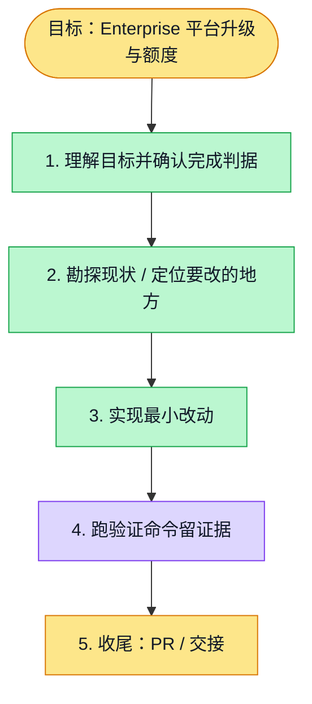

# 执行计划 — Enterprise platform management #6108

> 规范：`.harness/instructions/execution-plan-visualization.md`。
> 改状态用 `node .harness/scripts/execution-plan.mjs set <本文件> <节点> <状态>`，
> 改完 `check` 一遍；不要手改 classDef 颜色。

## 我理解的目标
- **目标**：平台人员对无已付 Team 的组织手动升级 Enterprise 并原子添加额度。
- **完成判据**：已有 PG/HTTP 19 与 UI/client 18 项通过；剩余只验新增留存边界及真实断响应浏览器，完整回归由必要 CI 验证。
- **不做什么**：已付 Team 续费取消与保留计划由后续完整支付适配实现，本轮失败关闭。
- **假设与待确认**：已签核设计；依赖容量许可单源、当前财务代际和正式 Enterprise operations。

## 执行计划

图例：⬜ 灰=未开始 · 🟨 黄=已开始 · 🟩 绿=已完成 · 🟪 紫=已测试（有证据） · 🟥 红=被堵塞

## 进度日志（append-only，每次改颜色追加一行）
| 时间 | 节点 | 状态变化 | 依据（命令 / 证据 / 堵塞原因） |
|---|---|---|---|
| 2026-11-02 | G, S1 | todo → doing | 接到目标，开始理解 |
