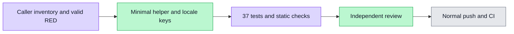

# Shared HTTP 403 permission fallback — #6222

Real quota QA found a valid authenticated member receiving HTTP 403 but being told that their session had expired. The canonical shared helper previously grouped 401 and 403. This independent maintenance gives 403 a fixed permission explanation in English and Chinese; 401 retains its exact authentication message.

Source `770c9a835721f2aaa7278303265b91ef32890d2b` changes only the shared status branch and one resource key per locale. Domain-specific adapters, requests, authorization, status/reason/raw diagnostics and all other HTTP branches are unchanged. Two existing research action-403 assertions required correction; its known KG_NOT_VISIBLE domain explanation is retained.

Root observed meaningful RED: 4 failures and 33 passing tests across five files (11.155s), caused by the old 403 authentication text. The same regression bytes remain frozen for GREEN. Tests cover both locales/default, 401, other statuses including the 500 boundary, design/home/artifact fallback paths, known-domain precedence and unmodified diagnostics. Caller inventory is recorded as read-only source references, not an assertion that every UI route was browser-tested.

Fresh GREEN: same 37/37 tests pass in 11.302s. Scoped ESLint exits 0 in 3.285s; infrastructure-free init exits 0 in 16.695s. Independent task/whole-branch exact-source review is CLEAN with no actionable P1/P2. Canonical tracked scanning and normal hooks remain subsequent gates. No new browser run is claimed by this shared-copy maintenance. Quota's original full seventeen-image chain will be rerun after this fix actually merges and is normally integrated there. Remote CI and develop delivery remain separate from local checks.

