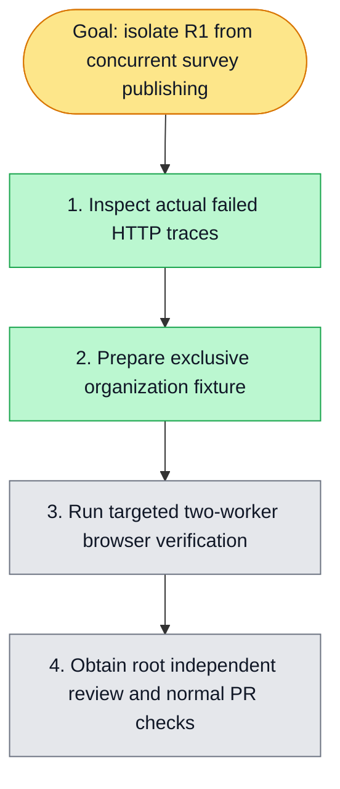

# Survey R1 isolation — issue #6118

Goal: R1 uses its own real organization/session, deletes only its own survey through the real UI, and preserves a foreign survey while trusted publishing runs concurrently.

Scope: R1 test and its dedicated fixture helpers. A private API-side CLI reuses the existing isolated credential/personal-local-org seed helpers; real UI login, organization creation and session switching follow. The shared admin's memberships/default org remain untouched. No production Survey/CAS change, billing change, global worker reduction or deletion retry.

Baseline: origin/develop 361c2c357f3c1dc4588d7f32e837e5a0eae523c5. First and only owned worktree: survey-r1-isolation-6118. Native worktree creation could not identify the subagent chat source repository, so git worktree fallback was used after fetching main/develop.

Existing real failure: queue candidate 69d25945f6a50ce2853866e44c76f389c1736ad6, run41397905503/job125123397658, artifact13120292348. Two workers ran concurrently. Initial DELETE acceab02-be28-4a8f-9978-fcbfde8a5736?expectedVersion=2 returned 409 SURVEY_VERSION_CONFLICT, traceId5169ab01-8f0b-41b8-9425-fb7b3d0dd91f. Retry DELETE44a403dc-8fd8-4ab4-b8e7-453b3d1dd1b5?expectedVersion=3 returned409 with traceIdacc678c0-eeb3-40ad-946c-66acb540d572; another authenticated list already showed version4. Both surveys had the trusted-publishing fixture title. R1's shared-org deletion raced that spec; backend CAS correctly rejected it. This differs from issue5992's closed-batch republish UI regression.

Planned verification (await coordinator resource window): standard with-test-isolation wrapper runs canonical fullstack-smoke config with two workers, selecting only R1 empty-list and both survey-trusted-publishing tests. Verify the foreign sentinel is unchanged and owned organization identity is real. No broad fullstack retry. Baseline init/dependency setup and browser/type checks have not been run in this new tree while root owns the resource window.
