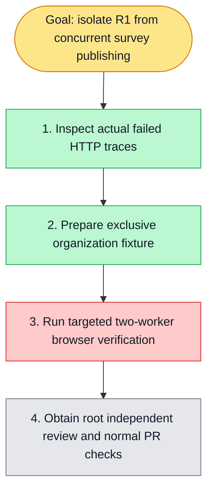

# Survey R1 isolation — issue #6118

Goal: R1 uses its own real organization/session, deletes only its own survey through the real UI, and preserves a foreign survey while trusted publishing runs concurrently.

Scope: R1 test and its dedicated fixture helpers. A private API-side CLI reuses the existing isolated credential/personal-local-org seed helpers; real UI login, organization creation and session switching follow. The shared admin's memberships/default org remain untouched. No production Survey/CAS change, billing change, global worker reduction or deletion retry.

Baseline: origin/develop 361c2c357f3c1dc4588d7f32e837e5a0eae523c5. First and only owned worktree: survey-r1-isolation-6118. Native worktree creation could not identify the subagent chat source repository, so git worktree fallback was used after fetching main/develop.

Existing real failure: queue candidate 69d25945f6a50ce2853866e44c76f389c1736ad6, run41397905503/job125123397658, artifact13120292348. Two workers ran concurrently. Initial DELETE acceab02-be28-4a8f-9978-fcbfde8a5736?expectedVersion=2 returned 409 SURVEY_VERSION_CONFLICT, traceId5169ab01-8f0b-41b8-9425-fb7b3d0dd91f. Retry DELETE44a403dc-8fd8-4ab4-b8e7-453b3d1dd1b5?expectedVersion=3 returned409 with traceIdacc678c0-eeb3-40ad-946c-66acb540d572; another authenticated list already showed version4. Both surveys had the trusted-publishing fixture title. R1's shared-org deletion raced that spec; backend CAS correctly rejected it. This differs from issue5992's closed-batch republish UI regression.

Verification attempted once at source f8bc399db64d886559fdada7b1151560f28db47d: the standard with-test-isolation wrapper selected only R1 empty-list and the trusted-publishing main case with two workers. Offline frozen dependency linking reused the cache (zero downloads); require.resolve confirmed both API/Web survey contracts resolve inside this worktree (workspace-resolution.txt). No full init or independent repository typecheck was run, following the user's narrower validation instruction.

Result: exit 1, zero tests executed. Admission normally waited 3m15s for load to fall below the existing threshold; API/DB became ready, but the fresh Next production build did not finish within the existing 600000ms webServer budget. This does not prove either browser assertion passed or failed. Raw output: targeted-two-workers.txt. No timeout/threshold change or automatic retry. Wrapper cleanup took 3s; exact project wsx-f6ef93414e90f3d936ca had no remaining containers, and wrapper/build PIDs had exited (cleanup.txt). The resource window was returned to the coordinator. Full verification remains required in CI or a separately authorized targeted run.

Root independently statically accepted the isolation implementation and the CLI timeout/nested-finally changes. No self-review approval or completion claim is made here. No verified module-skill experience was added before the targeted test executes.

PR #6121 normal pre-push passed 25/25 tasks (21 cache hits) without bypass and the branch was pushed. Its remote fullstack run41406522612/job125149829631 then executed the suite: 117 passed, R1 failed on its first explicit identity read, before creating/switching/deleting the owned survey. Both attempts returned500. Artifact13124566045 shows the UI's valid `/identity/me?orgId=local-...` returned200, then the fixture helper requested `/identity/me?orgId=local-.../identity/me` and received500 (ci-identity-urls.json). The seeded ID itself is valid; the helper failed to strip the observed query before appending a new route. No product identifier or identity behavior was changed.

The follow-up fixture fix derives the base from URL origin/pathname, and identity reads explicitly pass the actual account/new organization ID. Switching also waits for the real session's currentOrgId before continuing. A lightweight request spy reproduced the malformed URL (identity-url-red.txt); the corrected helper passed two cases for rewritten and direct API origins (identity-url-green.txt). The spy's first setup omitted response.status and was repaired before the recorded URL assertion red; that setup error is not counted as business red evidence. No local Next build or PG run was repeated. Final independent source review, normal hook and remote browser CI remain required for this increment.
