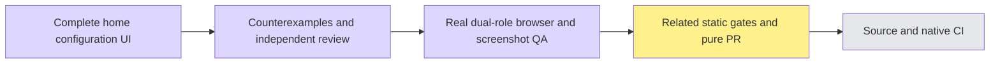

# Complete organization home configuration — #6204

The existing Appearance, Content, Layout and Preview tabs now switch Chinese/English, including logo/theme, brand/banner fields, presets/custom color/images, recommendation pickers/notes, quick actions, section controls, errors, validation, pending/saved feedback and administrator denial. Configured text, original catalog snapshots, notes, identifiers, images, colors, ordering, permissions and request semantics remain unchanged. Existing action labels and default metadata share canonical resources; dynamic before/after metadata snapshots are byte-identical.

Screenshot QA found that the old unconditional flex utility overrode inactive panels' hidden attribute. The first passing journey omitted this visibility check. Its counter-screenshots are retained in `first-run/`; new actual browser assertions then failed with expected hidden / received visible (`visibility-red/`). Only three conditional display classes changed; children remain mounted. Final fresh verification executes all six new inactive-panel assertions successfully.

Verified final application source: `95bf3f272e04eac0131a7acdeaa5a03a5726dd83`. Initial17semanticRED7.79s →17GREEN3.82s; broader68tests/5files8.44s. After the visibility correction,36related tests passed6.20s, scopedESLint and webtypecheck exited0. Root browser type/lint/spec registration/init quick also passed. Related testid gate passes5440references (37unparsed reported,21existing exemptions); wiring passes137routes/18withoutdata/167controllers without manifest changes.

Final real browser:1/1 passed,13.8s case /4m2s total including fresh production build and1s cleanup. Actual Chromium → proxy → API → PostgreSQL/object storage, no page interception. Recommendations were installed through real APIs. Logo and banner originals were read back byte-for-byte; invalid banner bytes were rejected. Authored drafts, raw agent/skill snapshots and notes survive locale/tab changes, save and reload. The actual HomeView preview remains inert under focus/Tab checks and starts no chat. Ordinary members read saved configuration with200, receive403 for a valid unauthorized update, cannot enter the configuration form, and see the authored content on their actual home page.

All13final screenshots were visually inspected. Scripted geometry assertions cover375/1280;820 is a visual preview check. Controls remain readable without observed horizontal overflow or inactive-panel bleed. Source names, titles and notes remain authored data. The rejection assertion checks non-success plus canonical feedback, not an exact415 status; native OS IME and every possible long Unicode/concurrent-edit scenario were not exercised. Existing snapshot clamping and palette algorithms were preserved. One minor English sentence-separator spacing issue in the preview notice is recorded for final copy polish.

Task review and whole-branch review were clean. The actual visibility finding was corrected by the original worker; one scoped final re-review confirms it addressed with no newP1/P2. Reports are alongside this file. Browser scope `wsx-593b53c25ee5c9ae6788` and RED scope `wsx-e3f703b62a3911e073bd` each had zero remaining containers after cleanup; shared windows were explicitly released.

This local branch explicitly depends on profilePR6203's shared resources. That PR is not merged: its native candidate exposed an existing notification response-body race already fixed in pendingPR6147. Main is running6147's actual candidate first; no duplicate maintenance PR or extra retry was started here. Publish this feature only after actual profile merge, fresh-develop integration and proof of zero inherited profile delta. Source CI/native candidate/merge remain independent delivery gates.

Delivery update: main coordinator explicitly authorized a stacked PR before #6203 merges. Its base is `worker/i18n-org-profile-6202`, isolating the home delta. Normal push, PR identity and later retarget/integration checks are recorded in the issue; this does not claim parent merge or develop-target CI. Final application/test source remains 95bf3f272e04eac0131a7acdeaa5a03a5726dd83.

Post-browser copy polish requested by main: one explicit JSX space separates preview status and personal-data sentences. A new semantic assertion actually failed on `changes.Personal`; after the one-character rendering fix all 17 UI cases and scoped ESLint passed. Full browser screenshots remain evidence for 95bf source; this later spacing-only delta was not rerun through the full browser. The earlier deferred spacing finding is addressed.
