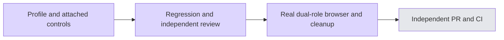

# Organization profile and attached controls — #6202

The real `/org-admin/profile` page, standing-tool grants and conversation-memory settings switch Chinese/English in place, including validation, authorization, dependency failures, pending actions, empty states and avatar feedback. Authored organization fields, image bytes, tool names, grant/approver IDs, timestamps as instants, API payloads and permissions stay unchanged. Locale changes do not reload the panels or replace drafts. Shared title/save/saved resources have one source.

Verified source: `3829bc44cb367deaa22cc9a334eaf1537a1d70cd`. Ten meaningful new tests first failed on missing behavior, then passed. Final related regression: 48 tests in nine files, 13.81s. Web/API typechecks, scoped ESLint, spec gate and standard init quick exited 0. Initial type failures and the subsequent explicit callback annotations/test-option fix are preserved as evidence.

Independent task review found no product P1/P2. Whole-branch review found two new browser locator mismatches: StateShell's saved paragraph has no status role, and denial text includes the localized organization-layer prefix. The existing component contracts were used to correct five assertions. Scoped re-review confirms both findings addressed and no new breakage; all five corrected assertions executed in the real browser.

The official fullstack seed ran twice against one isolated database, both exit 0 (36s including 1s cleanup). The private tenant's pre-existing standing grant is prerequisite data for real listing/revocation; this does not claim HITL approval creation or subsequent tool execution. The database scope was released and zero owned containers confirmed dynamically.

Fresh production browser: one registered case passed, 5.1s case / 4m2s total including fresh build and 1s cleanup. Chromium → same-origin proxy → actual API → PostgreSQL, no interception. The test proves raw name/description drafts survive language switching without refetch, exact save payload and persistence, actual server image-byte rejection and a valid uploaded image after reload, member profile/grant reads and writes denied with real 403s, administrator revocation and authoritative empty-list persistence.

Actual extraction capability was true: the administrator changed `orgEnabled` from false to true and verified reload persistence; the ordinary member could read but not change the setting. No deployment capability flag was forced. An early interpretation of an embedding-worker log as extraction unavailability was incorrect and was corrected before recording results. Unit tests separately cover the unavailable-deployment branch. Local list reporting does not persist the JSON test attachment; the executed conditional assertions and initial-off/final-on screenshots establish the observed branch.

All three screenshots were inspected: populated administrator page at 1280, member denial panels, and empty grant list at 820. The member screenshot captures the denial panels; the disabled memory control is additionally covered by browser assertions. These are profile-specific results, not evidence of all B8 pages, privileged platform writes, real model execution or production release.

Browser scope `wsx-6e155bc0d29e14734da1` and seed scope `wsx-86ed8d2a6ee60195c48d` each had zero remaining containers after cleanup. The shared heavy window was explicitly released. The local browser uses the existing project's precise `--grep` selection; unconditional CI project selection remains unchanged.

Nav #6201 actually merged at `2026-11-03T18:33:10Z` as `c49fee15b89f2621d8ceaa582ef6a9c0f6c931cc` (candidate 57 successful / 15 skipped / zero failed). Fresh main/develop were fetched and develop integrated in `6cd502308ce5b5aed6f16839263889a359e2bd7b`. A byte comparison confirms no web/API source changes from the already-verified tree, and the develop PR diff contains only profile implementation/tests/fixture/evidence, with no inherited Nav delta. Normal push/publication await the shared window; source CI and native-candidate checks remain separate from local proof and the main coordinator retains merge authority.

