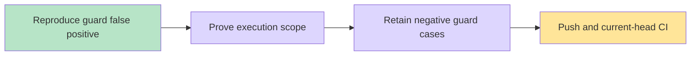

# PR6336 Python runtime guard compatibility

User reports validation failure on PR6336 (issue6335). Original head fc3dc31e5d8450ecf06f80c078e2b2db1e79f68f has one failed check: verify-control-plane, run42224063612/job127913186141. Actual failure is lint-ci-python-runtime.test.ts: verify-web-tests invokes the shared affected runner and was misclassified as API-capable despite validated CI_AFFECTED_WEB_SHARD selecting an exclusive web task.

Reused existing worktree, branch codex/pr6336-runtime-guard-fix from the PR remote, fetched main/develop and merged latest develop af3bd42d84d257e3b4624b2dd945d70236acbf20 without conflicts. COORD_GATEWAY_URL skipped by explicit user instruction. No new worktree.

Observed original local guard fail with the same offender before fixing. Guard now proves web-only mode only for the exact standalone runner command with validated literal shard or the closed four-value matrix. Resolves job/step env overrides; unknown/invalid selectors, shell mutations and other API steps still require Python. Unsharded/fork API fallback remains detected. No Python installation added to web shards; no CI check disabled.

Tests: guard6/6; affected runner31/31 including four real fixture shards with exact disjoint union; related CI contracts7 files81 tests. Runner web-shard execution assertions now include API in the planned tasks and cover both fork and same-repository inputs, proving API is never executed by a dedicated web shard. Independent read-only review found no actionable findings. Source whitespace check clean. Current-head remote verification remains required after push.

