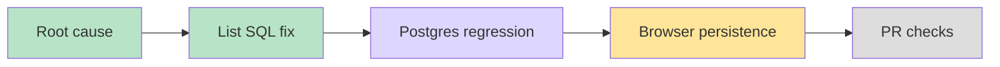

# Project invitation list persistence — #6339

User expects a project joined through its invitation link to remain discoverable after returning to /projects, reload, and future login. Reused existing worktree, fetched main/develop, started branch codex/project-invite-list from latest origin/develop. COORD_GATEWAY_URL skipped by user instruction.

Root cause: general invitation acceptance persists general_project_members; list membership SQL used only project_memberships, which is the workshop identity source. Ordinary general members and owners therefore disappear, while organization managers see the management projection.

Added two real PostgreSQL tests through issueProjectInviteLink + acceptProjectInvitation + listProjects using a fresh DB connection. Before source fix both failed with expected project versus empty list (red-postgres.txt). Kind-specific actor/tenant constrained EXISTS fixes discovery without granting roles or reading content. Same six metadata fields; existing permission-table assertion now explicitly includes both canonical membership tables.

Green:4 files32 tests passed, covering real acceptance, owner discovery, manager dedupe, stranger and cross-org exclusion, noninvited project exclusion, mixed workshop/general memberships, archived read-only listing, and membership removal. Browser registered in seeded lane; actual return/reload/fresh-login run currently in progress. Independent review requested.

Local browser did not run any tests: webServer failed to start within600000ms under host load rising to70–80. Isolation wrapper explicitly classified zero executed tests and cleaned owned containers (docker ps empty). Browser PASS must come from CI, not this run. Extra API typecheck was deliberately SIGTERM-stopped to avoid overlapping the browser build; it is not a successful validation. Mandatory pre-push typecheck/lint and current-head CI remain required. Independent source/test review clean; permission-path lint passed.

Serial affected static validation completed successfully:33/33 typecheck/lint tasks,18 cached,5m40s (static-checks.txt). This supersedes the deliberately aborted standalone typecheck; API and Web typecheck now both passed. Source review clean. Local browser startup failure remains a zero-test result and is not counted as PASS.
