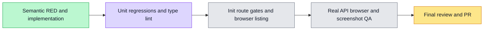

# Workflow grant management localization — #6207

The real organization workflow-grants screen and grant dialog now present both capability/workflow views,18capability explanations/fourlevels/targets, summaries/shortfalls/focus states, confirmation/impact/pending/errors/notices and audit in English/Chinese. Canonical levels/categories/IDs, rank/coverage, authorization, API arguments, effects, dialog selection, raw authored titles/member names and audit instants remain unchanged. Legacy Chinese helper/CAP_LEVEL defaults remain compatible; optional-locale helpers share pure typed resources. Raw failures and semantic notices render in the active language.

Application source b08f09c82c697818ec053c8a9eb8ee40d456259f, source review CLEAN. Initial14meaningful semantic RED5.30s. First implementation check27PASS/3root harness failures: Radix correctly aria-hid the synthetic outside locale control; root test control switched to text query, while real browser acceptance uses actual cross-tab locale synchronization. No product change for this test harness issue. New14+existinggrant11+runpanel39+resource/display tests total76/7files PASS4.42s; Webtype and8fileESLint exit0. Test/browser proof source708fccb7746e3a096ae60e1392056e3b056585c7. Static original/translated resource comparison preserves all18Chinese capability label/explanation pairs and4levels/descriptions; this is a static copy check, separate from runtime helper tests.

Root authored a registered real private-tenant admin grant→strictpayload/persisted audit→reload→revoke journey, real memberGET/PUT/DELETE403, deep-link focus, cross-tab dialog selection continuity,375/1280geometry and9viewport screenshots. No fixture/API/model/contracts/scanner/timeout changes. Actual browser, screenshotQA, init/route/static gates and final review are PENDING; no live backend acceptance or CI completion is claimed yet.

This branch starts from profile#6203 sourcebfb6080 and excludes home#6204 and CI#6210 changes. An explicitly authorized stacked PR may target the profile branch; main owns eventual develop retarget/integration/queue. No push/PR exists for6207 yet.

