# Workflow grant management localization — #6207

The real organization workflow-grants screen/dialog switches both capability/workflow views,18capability explanations/fourlevels/targets, summaries/shortfalls/focus states, confirmation/impact/pending/errors/notices and audit between English/Chinese. Canonical categories/levels/IDs, rank/coverage, authorization, API payloads/effects/selection, raw authored titles/member names and timestamps remain unchanged. Legacy Chinese helpers/CAP_LEVEL remain compatible; optional-locale helpers use pure typed resources. Failures retain raw data and notices retain semantic intent so both retranslate on render.

Application translation sourceb08f09c82c697818ec053c8a9eb8ee40d456259f. Initial14meaningful semanticRED5.30s. Root synthetic locale control initially failed in3tests because Radix correctly aria-hides the outside app; a test-only text query fixed that harness issue. Real browser switching uses the actual cross-tab locale channel. Total76tests/7files PASS4.42s includes new14/existinggrant11/runpanel39/resources/display. Webtype/8fileESLint, init/spec registration/wiring137routes167controllers pass. Static22entry comparison preserves18Chinese capability label/explanation pairs and4levels/descriptions; this is static copy evidence, separate from runtime assertions.

Two whole-branch review P2s in root E2E were fixed: reselect capability view after deep-link reload, and bind each audit to a newly emitted eventId absent in pre-mutation history then preserve that exact event after reload. Actual mobile screenshot counterexamples separately found missing vertical scrolling and long revoke footer clipping Cancel. Only owned DialogContent overflow-y-auto and DialogFooter flex-wrap changed; no shared Dialog, timeout, retry, force-click, authorization or payload change. Failed runs remain in browser-first/ and browser-second/, explicitly not acceptance.

Verified final behavior/test source:89a22aeb2a7faf0d2392615d94298ef86e502cc4; runtime evidence HEADc05394075710749eb3bedcb52e4cf30013957d63 is byte-identical for web/API. Final focused25/25PASS2.62s, webtype0, Dialog+E2Elint0, testid0, isolated exact listing1test/1file2s0. Testid scanner reports its existing36unparsed and21exemptions; no exemption/manifest changes. Exact checked count is in footer-testid.txt.

Third fresh production browser ACTUAL1/1PASS10.2s (4m1s total,1s cleanup). Chromium→realAPI→PostgreSQL verifies admin grant/revoke, strict payload/response schemas, NEW audit IDs/actor/timestamps, same events and grant state after reload, localized member names/date, initial deep-link focus, no locale refetch/write, cross-tab dialog selection, physical mouse wheel and full Confirm/Cancel visibility for grant/revoke at1280/375, and real memberGET/PUT/DELETE403 with unchanged server state. It does not execute a workflow or prove external side effects/model behavior. Private fixture actors/catalog are existing prerequisites, not seeded grant/audit outcomes.

All15 final-run screenshots were actually visually inspected: workflow/capability/audit desktop+mobile, grant/revoke top+footer desktop+mobile, member-denied375. Text/control wrapping is readable and mobile actions are fully reachable. At375 the existing audit table intentionally uses its contained horizontal scroller; this slice does not redesign it. Own scopewsx-57d5c526c41d17fee319 has0containers/no ownedAPI/web/provider listeners after exit. Image hashes and QA flags are in final-run/qa-status.json. Independent task/whole-branch/single scoped reviews completed; both original P2s ADDRESSED and no newP1/P2.

Post-browser copy polish: image QA spotted “The1workflows” grammar for a single blocked workflow. One English shortfall literal now uses count-neutral wording, preserving keys/parameters/Chinese/behavior. Existing resource catalog5/5PASS783ms and namespaceESLint0 verify this literal-only delta; full browser screenshots remain bound to89a22, not a claim of re-execution for the copy polish.

Delivery: explicit stack starts from profile#6203 sourcebfb6080 and excludes home#6204/CI#6210 changes. This evidence snapshot precedes publication; live normal-push/PR metadata is recorded in issue6207 and its PR conversation. Main owns develop retarget/integration and merge queue after the parent actually merges; no develop CI/merge claim here.

```mermaid
flowchart LR
 A[Implementation and static checks]:::tested --> B[Real API browser and15image QA]:::tested --> C[Independent reviews]:::done --> D[Literal polish check and normal push]:::doing --> E[Stacked PR and develop integration CI]:::todo
 %% evidence A: regression.txt footer-green.txt footer-type.txt footer-eslint.txt init.txt spec-gate.txt wiring.txt
 %% evidence B: final-run/browser.txt final-run/qa-status.json
 classDef todo fill:#e5e7eb,stroke:#6b7280,color:#111827
 classDef doing fill:#fde68a,stroke:#d97706,color:#111827
 classDef done fill:#bbf7d0,stroke:#16a34a,color:#111827
 classDef tested fill:#ddd6fe,stroke:#7c3aed,color:#111827
 classDef blocked fill:#fecaca,stroke:#dc2626,color:#111827
```

