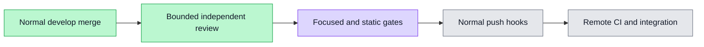

# PR #6211 accepted develop integration

Source merge `bf3d9de11ca7f4e5afb73c36cb1668c42e5838e0` normally merges published worker `4b4cb362cd599b11329e95960910869789b74c98` with accepted develop `ec1695d8fd646e004ca40dafbfa8e03bf01f20ef`. Four overlaps preserve both registries, both browser test sets, and module knowledge. Independent bounded review is CLEAN; protected trees and exact browser statement union are recorded alongside it.

Fresh checks at the source merge: 30/30 tests across three files; ESLint; infrastructure-free init; test-ID gate; UI wiring; canonical isolated listing exactly one workflow test. All exit 0. Individual receipts contain durations and private-log hashes. Scope `wsx-d229a8daa815f884513e` has zero containers, volumes and listeners on all eleven allocated ports after listing.

The historical real workflow browser run and fifteen inspected images remain bound to `89a22aeb2a7faf0d2392615d94298ef86e502cc4`. The later English count-neutral literal had resource/lint validation. This integration does not claim a new browser run. Existing workflow implementation/test bytes are preserved. The static namespace audit retains 113 nonliteral expressions without evaluating their runtime values.

Normal push hooks and remote source/candidate checks remain subsequent delivery gates. This evidence commit changes no application or test source; no actual develop delivery is claimed here.

