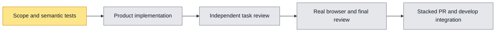

# Workflow grant management localization plan — #6207

Spec: [design.md](design.md). Root owns verification, browser, evidence, Git and external actions. One coherent implementation task; no concurrent implementers. Explicit stacked delivery may precede parent merge, but develop integration/CI is separate and main owns queue.

## Global Constraints
Preserve canonical IDs/levels, rank/covers, timestamps, raw authored workflow/member text, API payloads, permission guards and effect/selection behavior. Locale must not trigger reads/writes or reset selected levels. No backend/contracts/model/fixture/scanner/timeout changes. Namespace is pure resources; default Chinese helpers stay backward compatible. Reuse workflowDisplayName and memberLabel optional locale. Do not touch Chat picker/workflow display ownership.

## Task 1: Localize complete real grant screen and dialog
Read `design.md` first; it is binding scope. Own only:
- `apps/web/components/org-admin/workflow-grants-screen.tsx`
- `apps/web/components/org-admin/workflow-grant-dialog.tsx`
- `apps/web/lib/workflow-capability-grant-copy.ts`
- new `apps/web/lib/i18n/namespaces/workflow-grants.ts`
- imports/spreads for that namespace in `apps/web/lib/i18n/messages/{en,zh-CN}.ts`
Root test file `apps/web/tests/ui/workflow-grants-i18n.test.tsx` defines intended English labels; do not modify tests to fit implementation. Existing Chinese tests must retain behavior. Translate every remaining static user-facing sentence in owned files, all 18 known capability labels/descriptions plus safe unknowns, all four level labels/descriptions, targets and closed error map. `CAP_LEVEL` must remain Chinese-compatible; expose localized accessor for this page. Use typed key refs to eliminate duplicated Chinese strings. Helpers accept optional `Locale = "zh-CN"`.

Store failure/dialogError as unknown plus state/null discriminator as needed and render `describeWorkflowGrantFailure(raw, locale)` so already displayed errors retranslate. Notices retain category and canonical level intent, not translated text. Keep locale out of network callbacks/effect dependencies. Workflow titles use `workflowDisplayName(key,title,locale)` and audit member display `memberLabel(...,locale)`; audit date uses existing Intl options with current locale, without changing timestamp/timezone semantics. Dialog level initialization depends on canonical state only; do not reset on locale switch. Preserve deep-link focusing and case-insensitive resolution.

Root will execute tests and coordinate heavyweight resource windows. You may read and edit owned files only, inspect tests and existing patterns, and run no tests/type/lint/build/browser/PG/push. Do not commit/checkout/create worktrees, alter unrelated changes, spawn subagents or change contracts/test expectations. You are not alone in this codebase; accommodate others' edits and do not revert them. Write full report to `.superpowers/sdd/workflow-grants-6207/task-1-report.md`: status, files, implementation choices, self-review, checks actually run versus pending, concerns. Root captures/commits exact SHA before independent task review.

