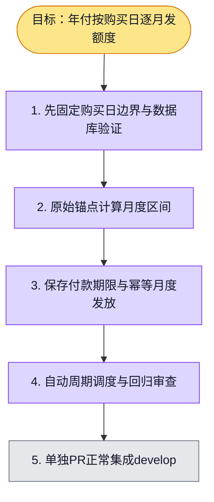

# 执行计划 — 年付月度额度 #6091

## 我理解的目标

按已确认个人支付设计，将已验证付款的月付或年付权益保存为独立付款期限，并按原始购买UTC日生成月度额度批次。年付首日只发一个月，后续月份到期再发；月末截断后下月恢复原日。

完成判据：日历边界测试、真实Postgres并发及重放/到期/债务验证、类型和lint、独立审查后单独PR正常集成develop。支付商在线下单、统一checkout与UI读模型在后续接线；本项不将内部已验证付款输入当作公共API授权。

## 实施顺序

1. tests/billing/personal-credit-calendar.test.ts先覆盖12个月、1月31日、2月29日、UTC毫秒、未来月份及非法期限。
2. domain/billing/personal-credit-calendar.ts提供纯日历函数，每个边界从原锚点独立计算。
3. 用独立新表记录已验证付款期限；金额/币种/SKU来自服务端目录核对，payment identity与所有者不可改配。
4. infrastructure/billing复用现有钱包与subscription periods、钱包锁、不可变ledger；持久化期限可扫描重放，读取和调度调用同一发放函数。
5. 隔离Postgres证明并发不重发、迟到调度会回收过期批次、永久余额和负债保留；所有失败事务不改变余额。
6. 证据落盘和独立审查，前置依赖合入后剥离stack，只建对应6091的PR。

## 进度日志

2026-11-01：已确认设计与issue6091；复用唯一worktree；等待上一项推送门控结束后开始本项代码。

2026-11-01：基础提交46a0541f8，provider57/PG41/类型/lint/init和独立审查通过。继续在同一issue完成后台周期worker：原锚点决定发放，next_check_at仅是可重建调度提示；用户读取与AI准入仍独立补齐。worker使用有界批次、跨实例幂等、停止时等待在途任务，单个账户失败不阻断后续账户。先补worker生命周期与真实数据库到期/不提前发放/错误隔离测试，再实现。
