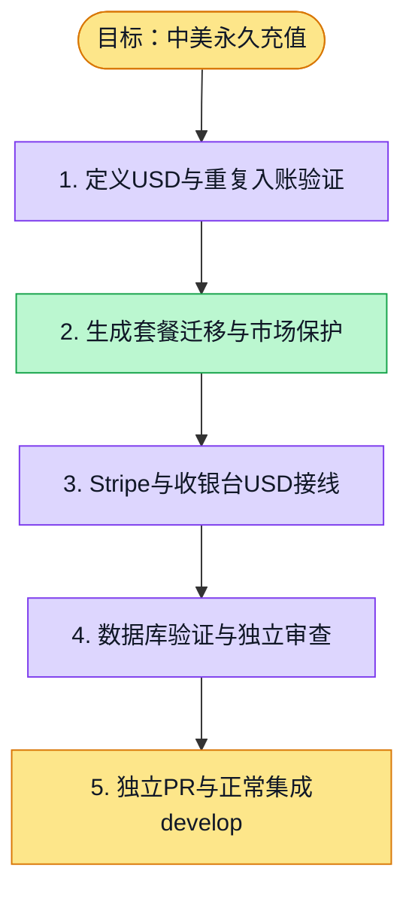

# 执行计划 — 中美永久充值 #6090

> 规范：`.harness/instructions/execution-plan-visualization.md`。
> 改状态用 `node .harness/scripts/execution-plan.mjs set <本文件> <节点> <状态>`，
> 改完 `check` 一遍；不要手改 classDef 颜色。

## 我理解的目标
- **目标**：真实支付订单按可信市场购买三档永久充值，币种及金额正确，重复通知只入账一次。
- **完成判据**：支付渠道专项测试、API typecheck/lint、真实 HTTP 金额/币种/鉴权/非法查询/503 边界通过。
- **不做什么**：本项不实现Pro订阅、统一checkout、赠送及旧数据重置。
- **假设与待确认**：按已确认个人支付设计；CN=CNY、US=USD、DevApp默认CNY并支持服务端USD测试配置，渠道可用性复用配置单源。

## 执行计划

图例：⬜ 灰=未开始 · 🟨 黄=已开始 · 🟩 绿=已完成 · 🟪 紫=已测试（有证据） · 🟥 红=被堵塞

## 进度日志（append-only，每次改颜色追加一行）
| 时间 | 节点 | 状态变化 | 依据（命令 / 证据 / 堵塞原因） |
|---|---|---|---|
| 2026-11-01 | G, S1 | todo → doing | 接到目标，开始理解 |
