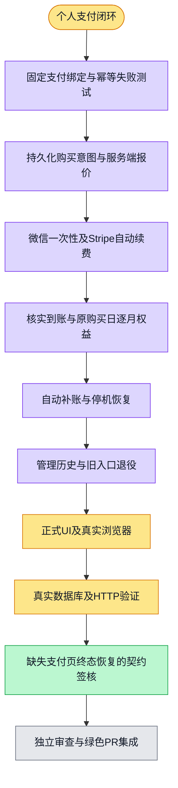

继续执行已获人工确认的个人支付设计；本项只承接个人购买与支付到账，不把 Team 或 Enterprise 混入 PR。使用唯一既有 worktree，支付超时、并发、乱序、错误归属与原始购买日是主要验证边界。

约束：先在本地 PostgreSQL 保存原请求／金额币种快照及 provider 幂等身份，再联系支付商；同一用户相同幂等键重试复用原意图，改 SKU／付款渠道／目录版本须冲突。创建支付与不可变账单/价格/Checkout查询在事务外。Stripe 可变订阅快照在绑定锁内重新读取一次（上游8秒期限，财务事务12秒statement/2秒lock期限），防止较早查询覆盖较晚取消状态；故障回滚、不持久化猜测状态。Stripe 为 subscription 模式及服务端 month/year recurring price，微信为 Native 一次性付款；不通过旧月卡 mode=payment 冒充自动续费。

支付确认只使用验签通知及支付商权威重读，并核对完整本地购买绑定、金额、币种、付款周期、订单／客户／订阅／账单关系；年付只记录一年付款期限并调用现有月度发放，续费沿用原购买日与月偏移。客户端身份、金额或回跳参数都不构成付款证明。超时不生成第二笔订单，旧 generation 事件不进入新账务。新入口在计费 epoch 正式激活前保持关闭，本项不运行生产清理或激活。

验证固定为 provider Vitest、隔离 PostgreSQL 支付／幂等事务用例、实际 HTTP 鉴权／严格输入测试、受影响包类型及 lint，最终精确 SHA 独立审查及 PR checks。支付商 HTTP fixture 证据会明确区分于真实商户在线扣款。
