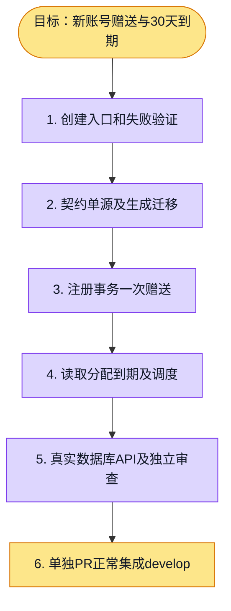

# 执行计划 — 新用户赠送 #6092

## 我理解的目标

新注册用户一次性获得个人1,000 credit，实际到账起30天到期；存量不补发，登录/切组织/加入第二组织不触发赠送。沿用已确认personal-pricing-v1设计，复用钱包和批次分配，新增明确welcome来源。

新计费版本的正式激活在最终旧数据重置窗口完成，本项只提供默认未激活的单例标记和资格读取，不执行生产清理/激活。账号创建与赠送同一事务；所有INSERT credentials的新建路径均覆盖。项目邀请遵守mod-project，角色与权限逻辑保持现有来源。

本项实现welcomeCreditGrant读取组件，完整个人权益HTTP路由由支付接线阶段注册；已有钱包/流水API可真实查看赠送余额和来源，不伪造尚未实现的Stripe订阅状态。

## 实施与验证顺序

1. 先定义契约/真实PG/注册事务测试，证明旧实现没有赠送/过期能力。
2. packages/contracts保留流水类型及来源的单源；新welcome类型不能冒充管理员或订阅赠送。迁移生成检查防止枚举漂移。
3. 赠送资格由数据库账号创建事实与新计费代际激活时间确定，默认不激活；代际独立于以后可变的商品目录版本。用户/组织资料保留。
4. 以credentials AFTER INSERT触发器统一覆盖所有真实新账号创建事务，使用已有调用方权限；不改身份/邀请/项目角色规则，已有账号UPDATE/入组不触发。
5. 消费按既有到期优先批次分配，钱包永久余额扣除赠送的未消费部分；读取组件返回真实欢迎额度及到账/到期，依赖错误不当作0。
6. 原有定时器及个人AI准入/钱包读取均能归一化到期；普通个人余额>=0准入规则不变。
7. 独立隔离实例激活测试标记，覆盖实际注册API、重复并发、30天边界、负债和永久余额；旧auth回归在未激活的独立实例运行。
8. 按唯一worktree和单issue/PR交付；前置依赖正常集成后剥离stack，不混入多个feature。

## 进度日志

2026-11-01：邮件6085会话确认不持有注册文件；读取真实入口并创建issue6092。基线a1d5cbf93，复用session唯一worktree。
