# Team / Enterprise 设计执行计划

目标：补齐已采用UI对应的可执行契约、原型消费和反例；正式一致性复核及人工签核后才开始runtime。Issue6099，复用本会话唯一worktree。已付未来窗口的业务口径单列等待人答，其余独立契约材料继续准备。

```mermaid
flowchart LR
 G([Team与Enterprise设计材料]) --> S1[核对真实组织与权限事实]
 S1 --> S2[用例与API草案]
 S2 --> S3[独立复核与问题定位]
 S3 --> B1[已付未来窗口处置待人答]
 S3 --> S4[可执行schema与原型消费验证]
 B1 --> S5[正式一致性复核]
 S4 --> S5
 S5 --> S6[人类签核]
 S6 --> S7[逐切片实现与真实验证]
 S7 --> S8[逐PR正常集成develop]
 classDef todo fill:#e5e7eb,stroke:#6b7280,color:#111827
 classDef doing fill:#fde68a,stroke:#d97706,color:#111827
 classDef done fill:#bbf7d0,stroke:#16a34a,color:#111827
 classDef tested fill:#ddd6fe,stroke:#7c3aed,color:#111827
 classDef blocked fill:#fecaca,stroke:#dc2626,color:#111827
 class G doing
 class S1 done
 class S2 done
 class S3 done
 class B1 blocked
 %% blocked B1: 已通过request_user_input_async询问已付年费剩余窗口处置，等待用户答；不默认停止/退款/折抵
 class S4 doing
 %% evidence S4: catalog/core/quote/entitlement schemas; contracts1336/prototype20/browser5/typeslint9; remaining responses and operations pending
 class S5 todo
 class S6 todo
 class S7 todo
 class S8 todo
```

草案复核不代替可执行第③件、正式复核或人工签核。B1只阻塞依赖该决定的升级影响/worker定稿与正式复核，不阻塞独立输入边界/表单契约。未获得答案不得默认停止、退款或折抵；不启用Team销售、Enterprise runtime、生产reset/epoch或部署。
