# Team / Enterprise 设计执行计划

补齐已采用UI的可执行契约、原型消费和反例；正式一致性复核及本束人工签核后开始runtime。Issue6099，复用唯一worktree。用户已确认升级后保留原已付Team发放计划，业务阻塞解除，记录见human-decisions.md。

```mermaid
flowchart LR
 G([Team与Enterprise设计材料]) --> S1[核对真实组织与权限]
 S1 --> S2[用例与API草案]
 S2 --> S3[独立复核与反例]
 S3 --> B1[已确认保留原已付发放计划]
 S3 --> S4[可执行契约与原型验证]
 B1 --> S5[正式一致性复核]
 S4 --> S5
 S5 --> S6[本束人类签核]
 S6 --> S7[逐切片实现与真实验证]
 S7 --> S8[逐PR正常集成develop]
 classDef todo fill:#e5e7eb,stroke:#6b7280,color:#111827
 classDef doing fill:#fde68a,stroke:#d97706,color:#111827
 classDef done fill:#bbf7d0,stroke:#16a34a,color:#111827
 classDef tested fill:#ddd6fe,stroke:#7c3aed,color:#111827
 classDef blocked fill:#fecaca,stroke:#dc2626,color:#111827
 class G doing
 class S1 done
 class S2 done
 class S3 done
 class B1 done
 %% evidence B1: human-decisions.md; explicit user reply on 2026-11-02
 class S4 tested
 %% evidence S4: calendar/core132, contracts1386, UI65, API/PG94; platform proposal complete; three independent UI review gaps fixed and under final verification
 class S5 done
 class S6 done
 class S7 todo
 class S8 todo
```

个人P5已真实合入develop 1f63fb1144a3b4df865fa88d62161303140ad164，前置证明见evidence/personal-prerequisite-merged。独立Draft检查点不代替正式一致性结论；该业务答复不等于整束签核。成员容量/小数PG账务等真实前置仍待实施，当前不开放Team销售，不执行生产reset/epoch或部署。
