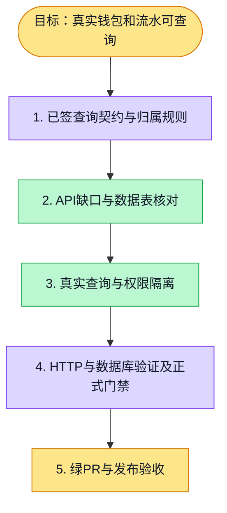

# 执行计划 — 真实钱包与流水查询

> 规范：`.harness/instructions/execution-plan-visualization.md`。
> 改状态用 `node .harness/scripts/execution-plan.mjs set <本文件> <节点> <状态>`，
> 改完 `check` 一遍；不要手改 classDef 颜色。

## 我理解的目标
- **目标**：登录用户读取自己的真实余额和流水，组织普通成员不能读取组织账，空钱包合法。
- **完成判据**：既定 wallet-ledger-query.test.ts 隔离数据库测试与API类型、门禁通过；PR绿且发布后实际接口可用。
- **不做什么**：本PR仅钱包查询；充值与订阅/token结算分属后续独立PR。
- **假设与待确认**：复用已签核billing-credits设计；个人与组织账独立，权限复用身份仓储和平台判定。

## 执行计划

图例：⬜ 灰=未开始 · 🟨 黄=已开始 · 🟩 绿=已完成 · 🟪 紫=已测试（有证据） · 🟥 红=被堵塞

## 进度日志（append-only，每次改颜色追加一行）
| 时间 | 节点 | 状态变化 | 依据（命令 / 证据 / 堵塞原因） |
|---|---|---|---|
| 2026-10-15 | G, S1 | todo → doing | 接到目标，开始理解 |
