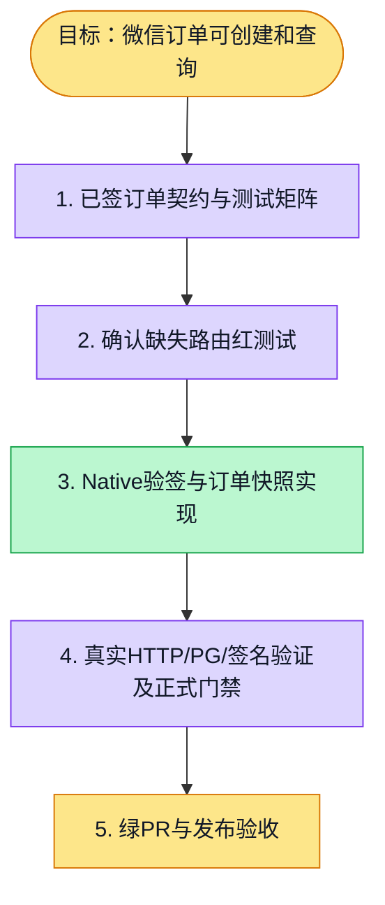

# 执行计划 — 微信Native充值订单

> 规范：`.harness/instructions/execution-plan-visualization.md`。
> 改状态用 `node .harness/scripts/execution-plan.mjs set <本文件> <节点> <状态>`，
> 改完 `check` 一遍；不要手改 classDef 颜色。

## 我理解的目标
- **目标**：按已签契约创建真实签名的微信Native订单，金额取服务端套餐；失败不落假订单，个人与组织归属隔离。
- **完成判据**：order-core.test.ts 与 order-ownership.test.ts真实PG/HTTP/签名测试、正式门控及绿PR。
- **不做什么**：本PR完成下单；回调入账、收银台、订阅与token结算仍是后续功能。
- **假设与待确认**：复用已签核billing-credits设计；个人与组织账独立，权限复用身份仓储和平台判定。

## 执行计划

图例：⬜ 灰=未开始 · 🟨 黄=已开始 · 🟩 绿=已完成 · 🟪 紫=已测试（有证据） · 🟥 红=被堵塞

