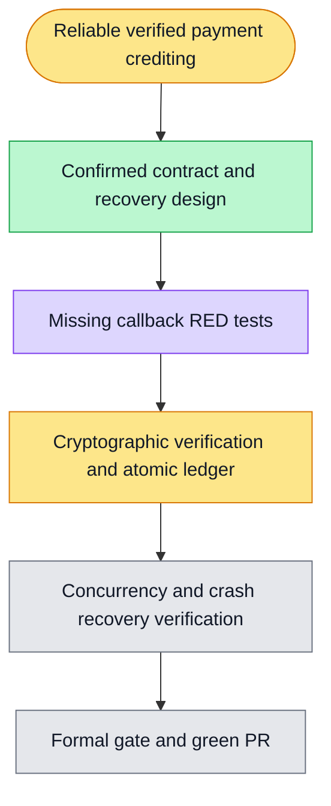

# Execution plan - verified WeChat notifications and durable crediting

Goal: verified payment receipts survive restarts and credit the correct wallet exactly once. Duplicate notifications, concurrent events, transaction failure, and lost ACKs must not lose or duplicate credits.

Verification: the prescribed wechat-notify-verify.test.ts and wechat-notify-crediting.test.ts use real PostgreSQL, HTTP, RSA/AES, and fault injection. Formal harness verification and current-head PR CI remain required.

Scope: raw callback, verification/decryption, durable receipt queue, shared atomic crediting, restart recovery. Cashier, expiry task, admin recovery UI, Stripe, and token settlement remain followups. No real merchant charge or production-login proof is claimed.

