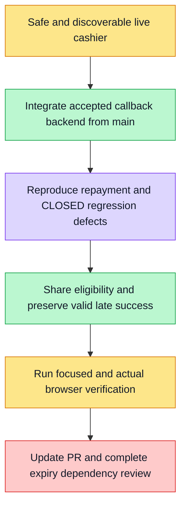

# Live cashier review follow-up

Goal: prevent repayment of a closed paid-funds manual-recovery order while preserving ordinary closed-order regeneration and genuine late SUCCESS. Share one eligibility predicate between hook and panel, retain order/support/refresh, reject illegal CLOSED status regressions. Current changes use the existing signed contract and public error fields; no raw internal messages.

Main9b8712004 contains the integrated F05 corrections. Resolved the F06 merge with those authoritative backend/tests/docs; kept only the existing allocated F06 covers mapping and refreshed derived progress. No human-signoff status or generated feature passing checkpoint was changed.

Verification first: new UI/hook counterexamples7fail25pass, then32pass after fix. Real browser driver now enters via the configured account menu instead of only the page purchase button; this new navigation assertion still awaits execution. Historical formal proof belongs to baf90a5fe, not this changed source.

F07 expiry backend remains a separate dependency under verification; existing PR5796 P2 thread stays open until actual backend expiry/regeneration evidence exists. No whole-feature or production payment acceptance claim.

