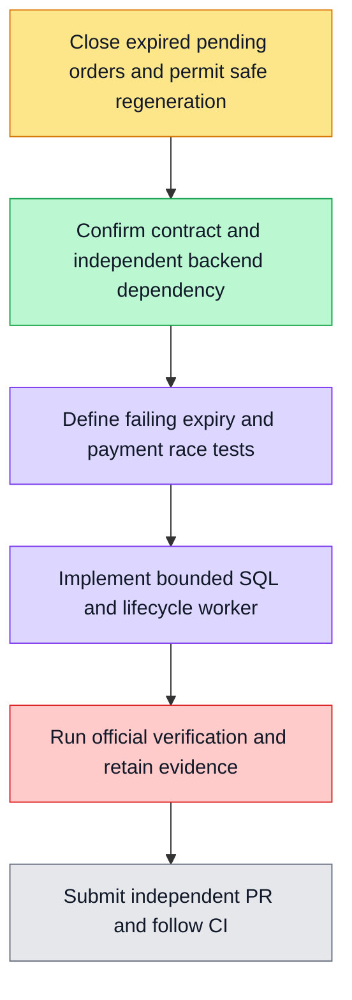

F07 closes expired pending orders through an owned restart-safe Nest lifecycle worker, using the existing shared database pool and literal SQL boundary. A bounded batch locks only eligible PENDING rows with SKIP LOCKED; SQL requires both created_at+15min and expired_at to be due, stamps closed_at and rechecks PENDING atomically. No wallet/ledger or merchant call is involved. Startup sweep catches downtime; one in-flight sweep per process, unref timer every60s and awaited shutdown. Multiple processes safely cooperate via row locks. Failures produce fixed-code diagnostics and retry next sweep without unhandled rejection.

Verification first: real PostgreSQL overdue/pending/boundary/terminal preservation, repeat and concurrent sweeps, held-row skip and callback races in both orders, late authenticated callback crediting exactly once, real controller CLOSED result. Fake timers check automatic startup/periodic sweep, no overlapping runs, recovery after failure and joined shutdown. Existing billing tests and full harness gate remain required. Only F07 changes; F05/F06 current CI/main closure remains owned separately. This follows the directly assigned payment goal outside the readiness queue (#2307 etc), recorded in issue5797.

Dependency order: F05 -> F07 -> F06; F07 depends on F05 global boundary/receipt kernel for late-payment safety. Separate F07 backend delivery ahead of cashier, no F06 UI or feature checkpoint in this branch.

